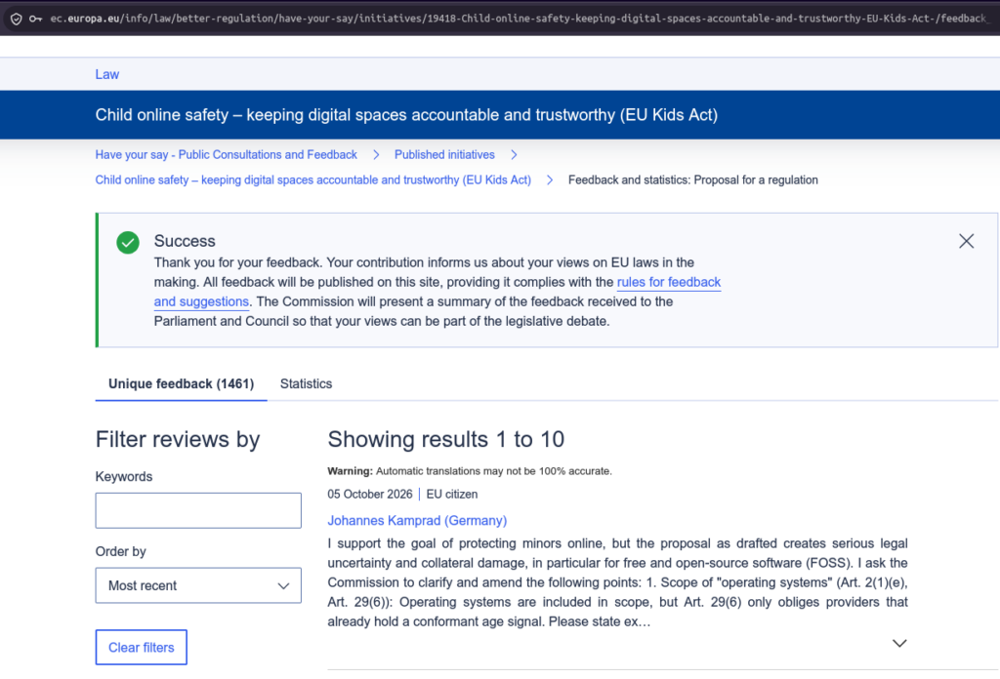

Yes, platforms do need restrictions—but not implemented from that direction. The correct approach would be to block all content that is not suitable for children by default.

Other content should only be accessible after age verification.

This means children would not need to verify their age. Instead, adults who want to access restricted content would need to verify that they are of legal age.

We should not implement systems that find or track children online.

That idea is fundamentally misguided, and no one will convince me that it is reasonable.

**But the fact is that no one can say anything, as it would make you against protecting children.**???

We can say we support the protection of children. Even if we do not agree with how it is implemented.

Real protection would need several key elements. These include \[insert points\]. We need an open discussion about how to implement this effectively. It's important to do this without compromising integrity and data protection.

[https://www.eff.org/deeplinks/2026/03/rep-finke-was-right-age-gating-isnt-about-kids-its-about-control](https://www.eff.org/deeplinks/2026/03/rep-finke-was-right-age-gating-isnt-about-kids-its-about-control)

[https://bbs.archlinux.org/viewtopic.php?id=312613](https://bbs.archlinux.org/viewtopic.php?id=312613) \[removed by moderation on archlinux\]

[https://blog.system76.com/post/system76-on-age-verification](https://blog.system76.com/post/system76-on-age-verification)

if the OS sends data to everyone in the internet asking for the age range.. that's not protecting kids it exactly the opposite technically telling everyone there is a kid. That's not how protection works. "you can take me out the hood
But you can't take the hood up outta me" kids will find a way around, that's very easy

Its the kids you needs to be taken away not the internet .. Kids today think the holy internet is everything. They believe it's the place you need to be, and it tells you everything. and its simply not it does not replace real life.

we must stop being afraid of having a voice against rules, even when it comes to the "protection of children". Either rules are drawn up by mutual agreement or it is a totalitarian decision. When it comes to the rules for car manufacturers, their associations are also included.

And Europe?

Germany?:

> In addition, the parents" right to bring up children, guaranteed in the Basic Law, could "constitute another obstacle to a ban on social media platforms".

[https://www.tagesschau.de/inland/gesellschaft/social-media-verbot-gutachten-100.html](https://www.tagesschau.de/inland/gesellschaft/social-media-verbot-gutachten-100.html)

[https://www.tagesschau.de/ausland/europa/meta-alterskontrolle-eu-100.html](https://www.tagesschau.de/ausland/europa/meta-alterskontrolle-eu-100.html)

## Feedback to the EU KIDS Act proposal (COM(2026) 681 final, 2026/0286(COD))

* * *

**Feedback reference:** F33577247

**Submitted on:** 05 October 2026

**Submitted by:** Johannes Kamprad

**User type:** EU citizen

**Country of origin:** Germany

**Initiative:** [Child online safety – keeping digital spaces accountable and trustworthy (EU Kids Act)](https://ec.europa.eu/info/law/better-regulation/have-your-say/initiatives/19418-Child-online-safety-keeping-digital-spaces-accountable-and-trustworthy-EU-Kids-Act-_en)

* * *

I support the goal of protecting minors online. However, the proposal's age assurance framework risks undermining privacy for **all** users and creates disproportionate obligations for small and non-commercial providers.

**1\. Reverse the burden of identification.** The proposal requires every user of covered services to prove their age, making minors identifiable while adults must prove adulthood. A privacy-preserving alternative exists: age-neutral access with adult verification only where content requires it (proof of adulthood, never of minority). Under the current design, every citizen interacting with covered services must either undergo age assurance or accept restricted functionality. This transforms an anonymous online environment into an identified one. I ask the Commission to assess whether a design based on adult-only verification (Article 7 ECHR, Article 8 ECHR, Articles 7 and 8 EU Charter) can achieve the same child safety objective.

**2\. Clarify the scope for operating systems (Article 2(1)(e) in conjunction with Article 29(6)).** The definition of "operating system" is imported from Regulation (EU) 2022/1925. It is unclear whether non-commercial providers of free and open-source operating systems, distributed without warranty and maintained by volunteers, fall in scope. Article 29(6) only obliges an OS provider that _has obtained_ an age signal to enable its sharing with user consent; but if the obligation is interpreted as an obligation to obtain signals, every Linux distribution would be affected. Please clarify that:

- OS providers that do not collect or process any age data have no obligations under Article 29(6);

- no obligation is imposed on local, non-networked operating system accounts;

- free and open-source software distributed at no cost without commercial activity is not treated as a provider where no service is offered to EU minors.

**3\. Proportionality for small and non-profit providers.** The proposal explicitly rejects exemptions for small and micro enterprises. For volunteer-run services (community forums, self-hosted applications, non-profit encyclopaedias — the latter partially exempted), mandatory third-party age verification is technically and financially unfeasible and will simply remove these services rather than protect children. I ask for a real, functional de minimis exemption and public, free-of-charge age assurance infrastructure (beyond the EU Age Verification Wallet) so that compliance does not require commercial contracts.

**4\. Risks of the verification market.** Mandatory age assurance creates a market of identity data concentrated in a few providers. A single breach or misuse of an age-verification database would constitute a permanent, irreversible harm: age cannot be changed like a leaked password. The Commission should require data minimisation by design (age bracket only, zero-knowledge proofs, no retention), prohibit provider-side profiling, and strictly limit Article 29 so that age data are shared only once, with explicit consent, and never repurposed.

**5\. Legal conflict with free software licensing (e.g. GPL v3).** The Regulation imposes obligations on "providers" of operating systems (Article 4 anti-circumvention, Article 29(6)), triggered by _offering_ the service (Article 2(2)) — a concept that is undefined for cost-free distribution. Free software licences such as GPL v3 expressly permit redistribution **without any warranty**, by anyone, without conditions ("NO WARRANTY", Article 15/16 GPL v3), and Article 7 GPL v3 permits compliance with law only as long as it does not restrict licence freedoms. If a Regulation obligation (e.g. warranty-type accountability, conformity assessment, obligation to operate an age-signal interface, or retaining legal responsibility after redistribution) attaches to anyone who redistributes the software, the effect is that the software **cannot lawfully be published at all** under its licence: every contributor and packager would inherit provider duties they cannot assume, and adding such conditions would violate GPL v3. The result would be a de facto ban on distributing EU-facing free operating systems. I ask the Commission to state explicitly that:

1. mere distribution of free software at no cost is not "offering a service" within the meaning of Article 2(2);

3. regulatory obligations do not attach to redistributors who did not originate or operate a service;

5. open-source operating systems developed and maintained by volunteer communities are outside the definition of "provider"; and

7. a corresponding exemption mirroring Article 2(4), point (d), is added for free and open-source operating systems not provided commercially.

**6\. Effectiveness.** Age verification is trivially circumvented by minors (misdeclared data, borrowed documents, VPNs, shared accounts), while its privacy cost applies to everyone. Please publish the evidence that the access delay (Article 6) improves measurable child welfare outcomes before mandating the framework, and provide a sunset/evaluation clause with binding criteria.

* * *

Ich unterstütze das Ziel, Minderjährige online zu schützen. Der Entwurf birgt jedoch das Risiko, die Privatsphäre **aller** Nutzer zu untergraben, und stellt unverhältnismäßige Anforderungen an kleine und nicht-kommerzielle Anbieter.

**1\. Umkehrung des Identifizierungsdrucks.** Der Entwurf verlangt von jedem Nutzer nachgelagerter Dienste einen Altersnachweis: Minderjährige werden identifizierbar, Erwachsene müssen ihre Volljährigkeit belegen. Ein datenschutzfreundliches Modell wäre der umgekehrte Weg: altersneutrale Angebote, mit Volljährigkeitsprüfung nur dort, wo Inhalte dies erfordern — nie ein Nachweis von Minderjährigkeit, um auszuschließen. In der jetzigen Form muss jede Person, die einen betroffenen Dienst nutzt, entweder eine Altersprüfung durchlaufen oder eingeschränkte Funktionen akzeptieren. Das verwandelt einen anonymen Online-Raum in einen identifizierten. Ich bitte die Kommission zu prüfen, ob ein Modell allein auf Basis der Volljährigkeitsprüfung (Art. 8 EMRK, Art. 7 und 8 GRCh) dasselbe Kinderschutzziel erreichen kann.

**2\. Anwendungsbereich für Betriebssysteme klären (Art. 2 Abs. 1 lit. e i. V. m. Art. 29 Abs. 6).** Die Definition „Betriebssystem" wird aus der Verordnung (EU) 2022/1925 übernommen. Es ist unklar, ob nicht-kommerzielle Anbieter freier Open-Source-Betriebssysteme — ohne Gewährleistung, von Freiwilligen gepflegt — erfasst sind. Art. 29 Abs. 6 trifft nur OS-Anbieter, die ein Alterssignal _erhalten haben_; wird die Pflicht aber so ausgelegt, dass Signale zu beschaffen sind, wären alle Linux-Distributionen betroffen. Ich bitte um Klarstellung, dass:

- OS-Anbieter, die keinerlei Altersdaten erheben oder verarbeiten, keine Pflichten nach Art. 29 Abs. 6 haben;

- lokale, nicht netzwerkgebundene Benutzerkonten keine Pflichten auslösen;

- unentgeltlich verbreitete Freie Software ohne kommerzielle Aktivität nicht als Anbieter gilt, wenn kein Dienst für minderjährige EU-Nutzer angeboten wird.

**3\. Verhältnismäßigkeit für kleine und gemeinnützige Anbieter.** Der Entwurf schließt Ausnahmen für kleine und Kleinstunternehmen ausdrücklich aus. Für ehrenamtlich betriebene Dienste (Community-Foren, selbst gehostete Anwendungen) ist eine verpflichtende Fremd-Altersprüfung technisch und finanziell nicht leistbar — das Ergebnis wäre das Verschwinden dieser Dienste, nicht mehr Kinderschutz. Ich bitte um eine echte, funktionsfähige De-minimis-Ausnahme und um eine öffentliche, kostenlose Age-Assurance-Infrastruktur (über den EU Age Verification Wallet hinaus), damit Compliance keine kommerziellen Verträge erfordert.

**4\. Risiken des Prüfungsmarkts.** Verpflichtende Altersprüfung schafft einen Markt, in dem Identitätsdaten bei wenigen Anbietern konzentriert werden. Ein einziger Vorfall in einer Altersprüf-Datenbank wäre ein dauerhafter, irreversibler Schaden: Ein Alter lässt sich, anders als ein geleaktes Passwort, nicht ändern. Ich bitte um: Datensparsamkeit per Design (nur Altersklasse, Zero-Knowledge-Verfahren, keine Speicherung), Verbot der Profilbildung durch Prüfdienste und strenge Begrenzung von Art. 29 (Weitergabe nur einmal, nur mit ausdrücklicher Einwilligung, keine Zweckänderung).

**5\. Rechtliche Kollision mit Lizenzen Freier Software (z. B. GPL v3).** Die Verordnung begründet Pflichten für „Anbieter" von Betriebssystemen (Art. 4 Anti-Umgehung, Art. 29 Abs. 6), ausgelöst durch das _Anbieten_ des Dienstes (Art. 2 Abs. 2) — ein Begriff, der für unentgeltliche Verbreitung undefiniert ist. Lizenzen Freier Software wie die GPL v3 erlauben ausdrücklich die Weitergabe **ohne jegliche Gewährleistung**, durch jeden, ohne Bedingungen („NO WARRANTY", Art. 15/16 GPL v3); Art. 7 GPL v3 gestattet die Befolgung gesetzlicher Pflichten nur, soweit sie die Lizenzfreiheiten nicht einschränken. Hängt eine Verordnungspflicht (etwa Gewährleistungs-Verantwortlichkeit, Konformitätsbewertung, Pflicht zum Betrieb einer Alterssignal-Schnittstelle oder fortbestehende Verantwortlichkeit nach der Weitergabe) an jeder Person, die die Software verbreitet, ist die Software **unter ihrer Lizenz faktisch nicht mehr rechtmäßig veröffentlichbar**: Jeder Mitwirkende und Paketierer würde Anbieterpflichten erben, die er nicht übernehmen kann, und das Anbringen solcher Bedingungen verletzte die GPL v3. Ergebnis wäre ein faktisches Verbreitungsverbot freier, in der EU genutzter Betriebssysteme. Ich bitte die Kommission um ausdrückliche Klarstellung, dass:

1. die bloße unentgeltliche Verbreitung Freier Software kein „Anbieten eines Dienstes" i. S. d. Art. 2 Abs. 2 ist;

3. Verordnungspflichten nicht an Weiterverbreiter anknüpfen, die einen Dienst weder begründet noch betreiben;

5. von Freiwilligen-Gemeinschaften entwickelte und gepflegte Open-Source-Betriebssysteme nicht unter den Begriff „Anbieter" fallen; und

7. eine Ausnahme entsprechend Artikel 2 Absatz 4 Buchstabe d für unentgeltlich bereitgestellte freie Open-Source-Betriebssysteme ergänzt wird.

**6\. Wirksamkeit.** Altersprüfungen sind durch Minderjährige leicht zu umgehen (falsch angegebene Daten, Dokumente von Dritten, VPNs, geteilte Konten), während die Privatsphäre-Kosten alle treffen. Bitte legen Sie die Evidenz offen, dass die Zugangsverzögerung (Art. 6) messbare Kinderwohl-Effekte zeigt, und verankern Sie eine Evaluierungs- und Sunset-Klausel mit bindenden Kriterien.
