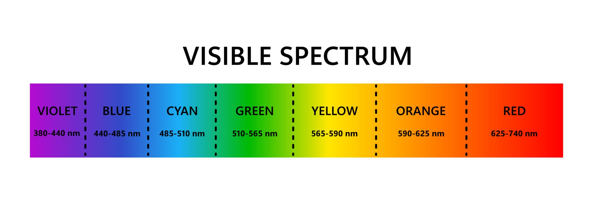

Humanity’s relationship with the electromagnetic spectrum is far from impartial. While we might claim to be rational beings, our wardrobes and living rooms suggest we are essentially sophisticated primates with very specific pigment fixations. Whether you curate a sanctuary of muted "greige" or prefer a home that looks like a high-speed collision in a crayon factory, your brain is constantly reacting to these wavelengths.

But while **Color Psychology** has long explored how hues influence our mood, recent data suggests that surrounding ourselves with specific "flavors" of light can actually overclock our internal hardware.

Humanity’s relationship with the electromagnetic spectrum is far from impartial. While we might claim to be rational beings, our wardrobes and living rooms suggest we are essentially sophisticated primates with very specific pigment fixations. Whether you curate a sanctuary of muted "greige" or prefer a home that looks like a high-speed collision in a crayon factory, your brain is constantly reacting to these wavelengths.

But while **Color Psychology** has long explored how hues influence our mood, recent data suggests that surrounding ourselves with specific "flavors" of light can actually overclock our internal hardware.

* * *

## Blue Light: The Cognitive Turbo-Charger

According to neuroscientific inquiries—specifically research emerging from **Harvard Medical School** and the **University of Arizona**—the color blue does more than just look "serene." It appears to be a biological optimization tool.

Exposure to short-wavelength (blue) light triggers specific photoreceptors in the eye that communicate directly with the brain's circadian pacemaker. The result? A measurable spike in **cognitive performance**. It’s essentially a double espresso for your neurons, minus the jitters and the overpriced latte.

Visible light spectrum. Optical light wavelength. Electromagnetic visible color spectrum for human eye. Vector gradient diagram with wavelength and colors. Educational illustration on white background

## The "Vastness" Hack: Creativity vs. Vigilance

There is a fascinating psychological divergence between how we process "warm" versus "cool" tones:

- **The Red Alert:** Evolutionarily and socially, we have been conditioned to see **red** as a biological "stop" command. From ripening berries and blood to stop signs and the dreaded ink of a teacher’s correction pen, red triggers a state of high vigilance. It’s great for detail-oriented tasks where you don’t want to make mistakes, but it’s the ultimate buzzkill for "big picture" thinking.

- **The Blue Horizon:** In contrast, **blue** is the color of cognitive expansion. Because our ancestors spent eons looking at the vastness of the sky and the sea, our brains interpret blue as a signal of safety and openness.

### Why it works:

When the brain isn't busy scanning for "red" threats or errors, it enters a state of **relaxed alertness**. This neurological sweet spot allows for greater associative thinking—the ability to connect seemingly unrelated ideas. In short: red keeps you from crashing your car; blue helps you write the next great novel.

* * *

> **The Scientific Upshot:** If you want to maximize your output, don’t just work harder—manipulate your photons. Surrounding yourself with blue light doesn't just make you feel "zen"; it functionally expands your mental workspace, allowing your brain to stop worrying about the "stop signs" of life and start navigating the open ocean of creativity.
