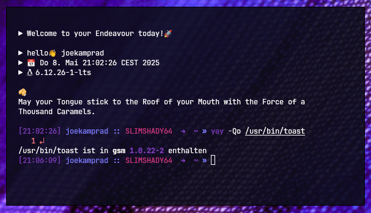

Recipes for the nerd of the tomorrow...

## Toast

We all know, the grown nerd does not eat a whole grain bread; it has to be TOAST.

This preference often stems from a nostalgic longing for the simple pleasures of childhood breakfasts. The cloudy appearance of perfectly toasted bread is not merely aesthetic; it signifies a texture that is uniquely inviting. This delicate fluffy consistency, paired with a sweet undertone, creates a delightful contrast to the more robust flavors typically found in whole grain options. Moreover, the absence of crust not only adds to its soft allure but also makes it easy to enjoy with a variety of toppings, from creamy butter and jam to indulgent spreads, enhancing the experience of each bite.

## **Here is my recipe:**

The toasted bread that even your children prefers to eat than bought "Supersandwich"

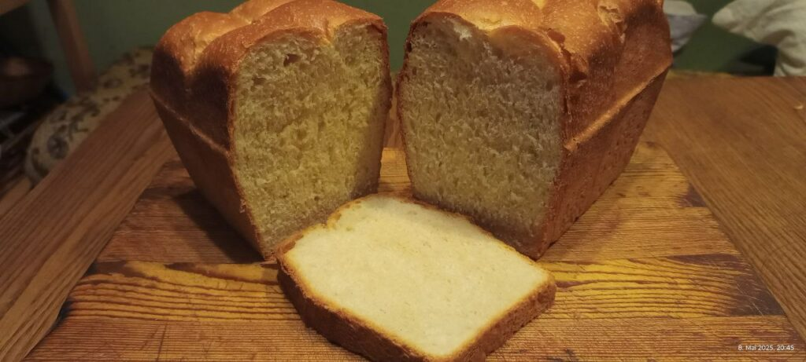
**Ingredients:**

- 4 cups all-purpose flour (500g)

- 4 tbsp (½ stick) butter, soft and at room temperature (60g)

- 2½ tbsp cornstarch (20g)

- 2½ tsp salt (15g)

- 1 tbsp sugar

- 1 packet active dry yeast (2 tsp)

- 1 packet whipped cream stabilizer

- ¾ to 1¼ cups lukewarm water (200–300ml)

**Preparation:**

Dissolve the yeast and sugar in about ½ cup of the warm water. Mix all dry ingredients together. Add the butter and the yeast mixture, then gradually add the remaining warm water—start with less and add more as you knead, until you get a smooth, cohesive dough. It’s best to knead the dough using a stand mixer with a dough hook. Otherwise, kneading by hand works too, but be prepared—it needs to be kneaded for 10 full minutes (set a timer!) to develop the gluten structure we want.

Place the dough in a bowl, cover, and let it rise for at least 20 minutes. It should noticeably increase in volume.

Divide the dough into 2 parts, then each into 4, and those 4 into 8 pieces. Shape each of the 8 pieces into smooth balls. Place them in a loaf pan, two balls next to each other. Place a second loaf pan upside down on top, cover with a kitchen towel, and let the dough rise again until it has doubled in size—this can take 1 to 2 hours depending on room temperature.

Bake in a preheated oven at 350°F (180°C), using convection or top and bottom heat, for about 45–50 minutes. Keep the second loaf pan on top during baking to prevent the toast from drying out. Alternatively, you can use a pullman loaf pan with a lid if you have one.

Remove the toast from the pan and let it cool completely on a wire rack. After about 10 minutes, optionally lay a clean kitchen towel over the bread to keep the crust soft.

* * *

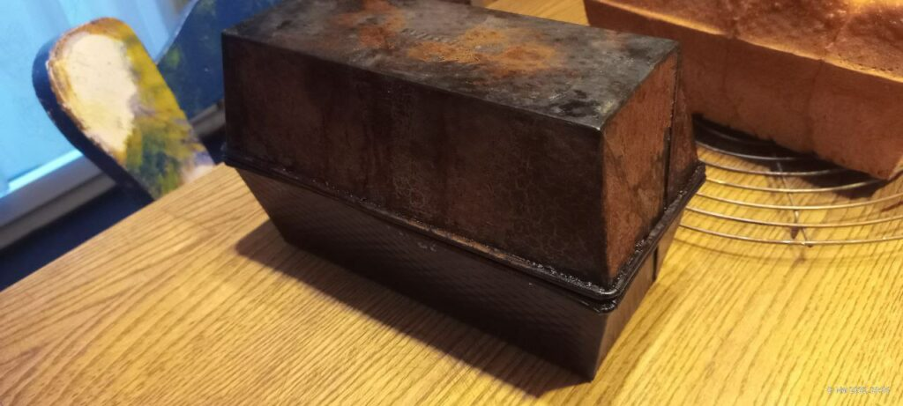

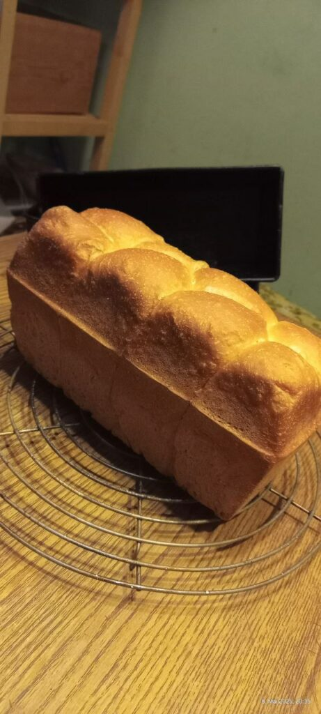

[Soft Toast Bread Recipe US_English (PDF)](/files/Soft_Toast_Bread_Recipe_US_English.pdf)

## **Beerentiramisu**

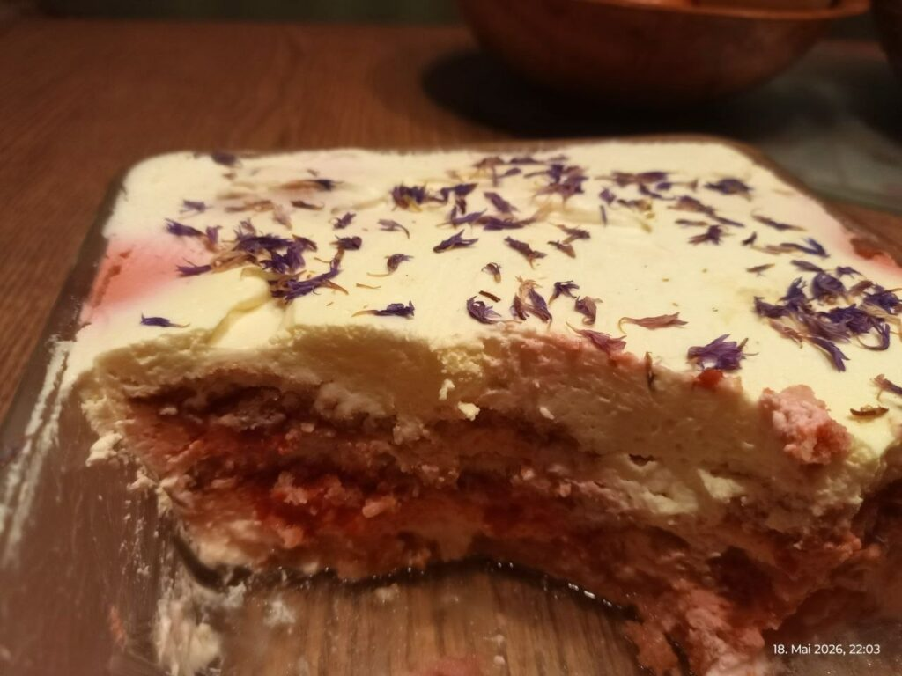
A fruity summer variant of the traditional Tiramisu using Yoghurt and no Eggs

[Berry Tiramisu US_English (PDF)](/files/berry-tiramisu.pdf)

[Beeren Tiramisu DE_Deutsch (PDF)](/files/beeren-tiramisu.pdf)

## Klassisches Tiramisu (Pavoni & Shustov Edition)

Ein authentisches Tiramisu-Rezept mit Bourbon-Vanille, optimiert für 250g Mascarpone und Espresso aus der [Pavoni Europiccola](/blog/la_pavoni_europiccola/) (Baujahr 1976).

## Zutaten

- 250g Mascarpone

- 2 frische Eier (Größe M oder L)

- 50g Zucker & etwas echte Bourbon-Vanille

- 100-150g Löffelbisquits

- 150-160ml Espresso (Pavoni Double-Grind)

- 1 Shotglas Shustov Brandy

- Ungesüßtes Kakaopulver

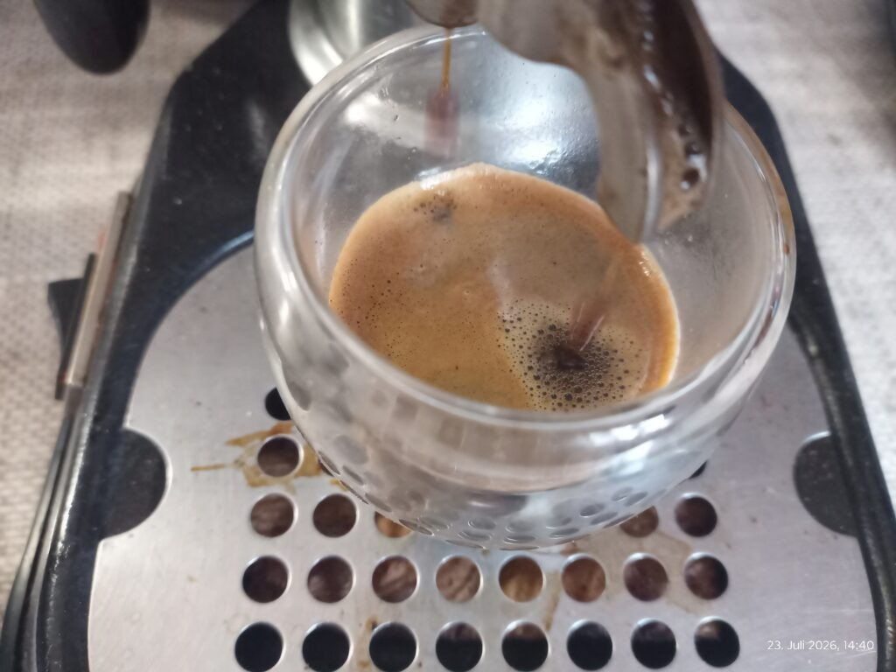

## Zubereitung

**1\. Der Espresso & Brandy:** Zuerst den Espresso ziehen. Ideal ist die Double-Grind Methode mit einer Handmühle. Den Espresso direkt mit dem Brandy mischen und abkühlen lassen.

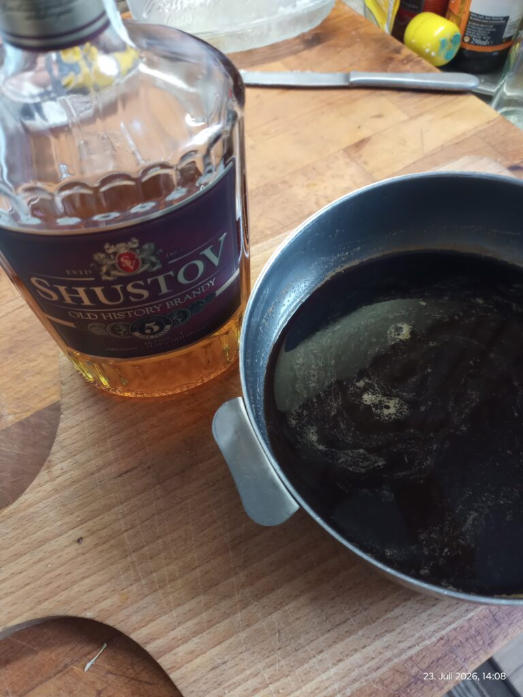

**2\. Die Creme:** Eigelb mit Zucker und Bourbon-Vanille sehr hell schlagen. Mascarpone unterrühren und zum Schluss den steifen Eischnee vorsichtig unterheben.

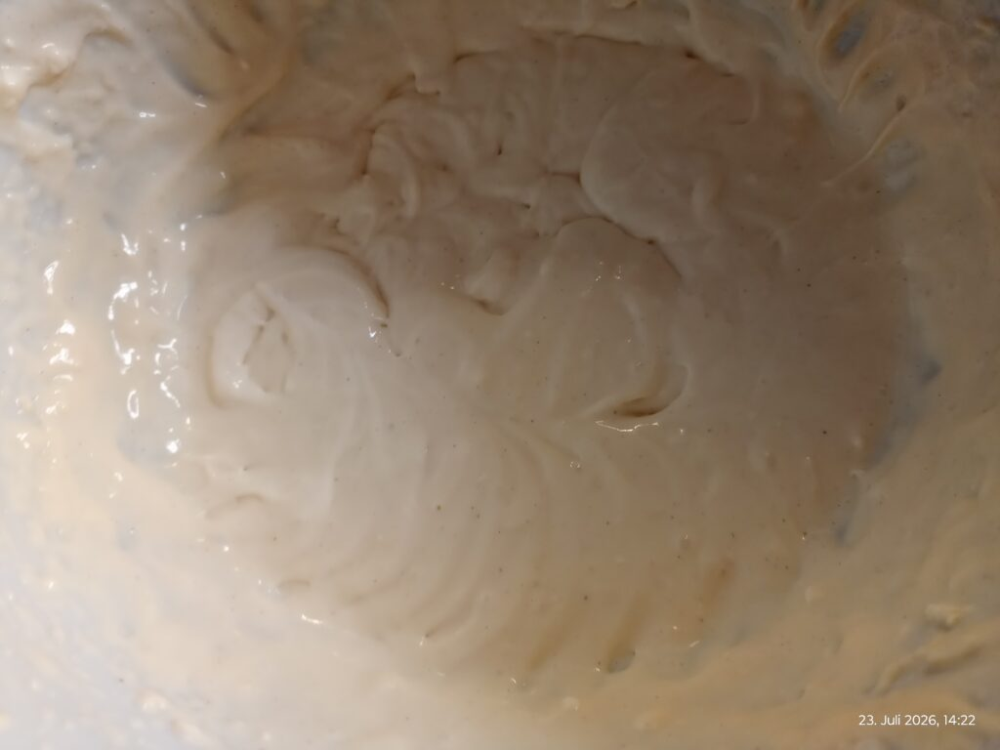

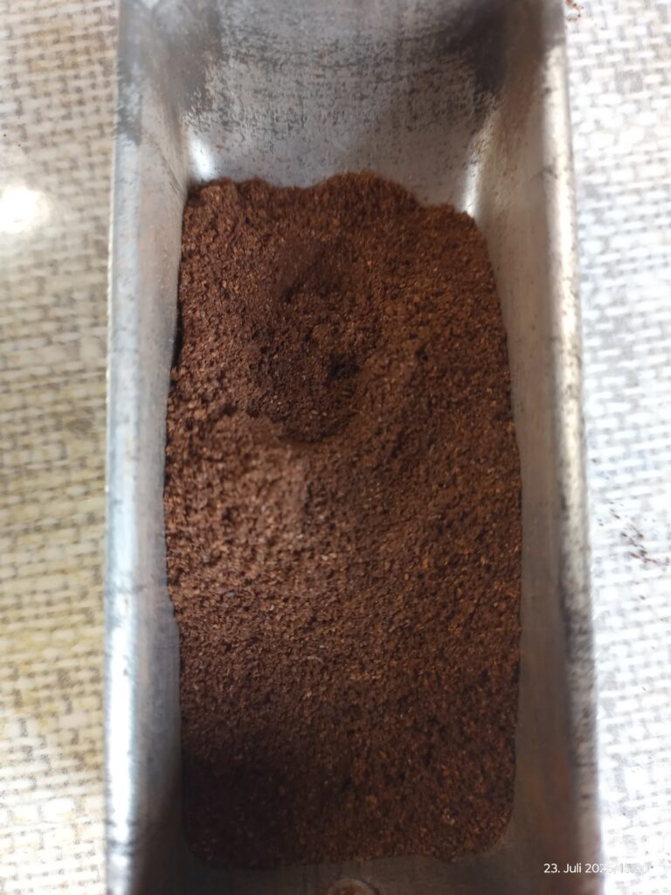

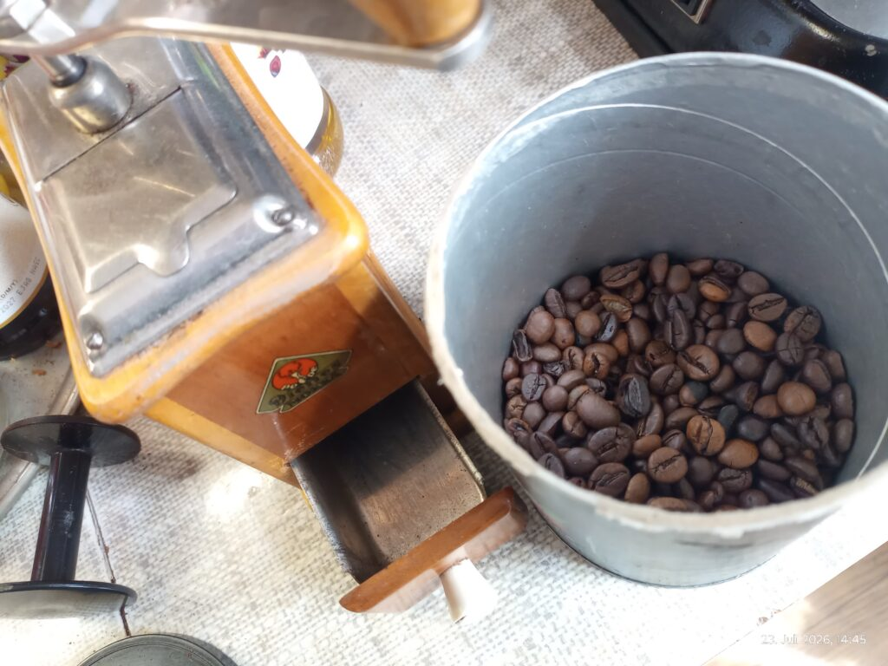

### Barista-Tipp: Double-Grind Methode

Für Handmühlen wie die PeDe: Erst grob schroten, dann fein mahlen. Das schont die Mechanik und sorgt für ein perfektes Ergebnis bei der Pavoni.

**3\. Finale:** Bisquits tunken, schichten und mindestens 4 Stunden kalt stellen. Vor dem Servieren mit Kakao bestäuben.

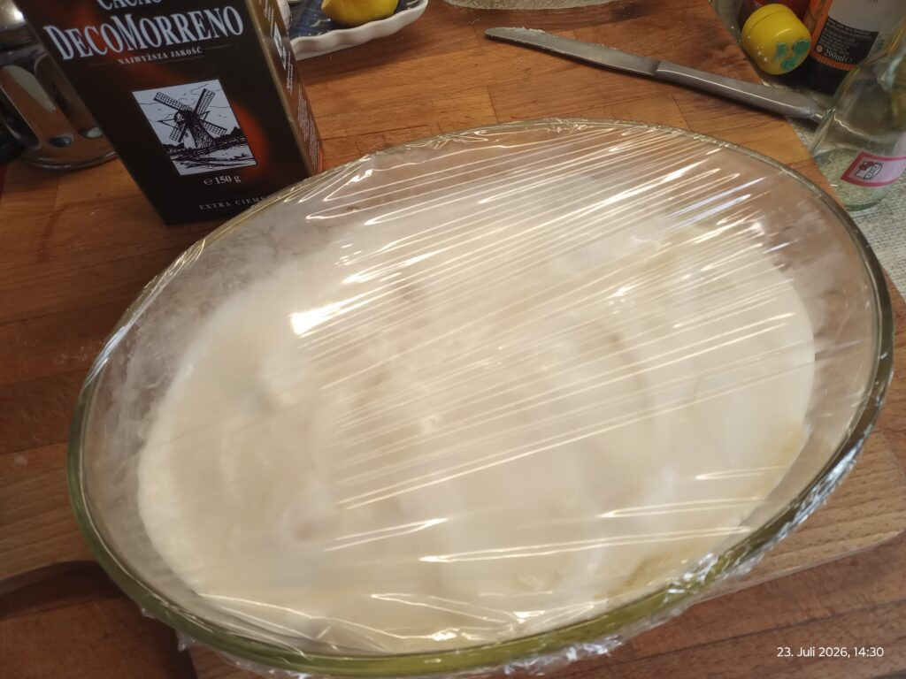

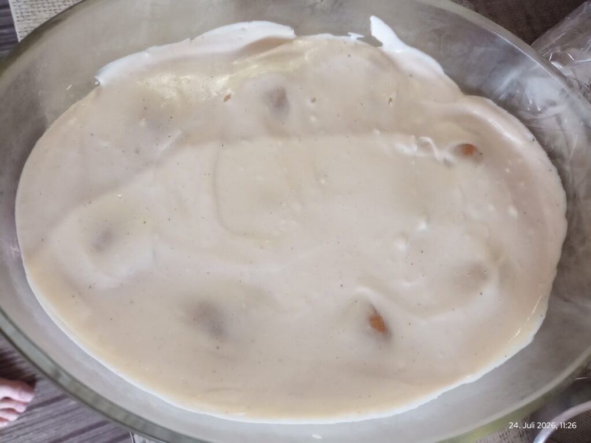

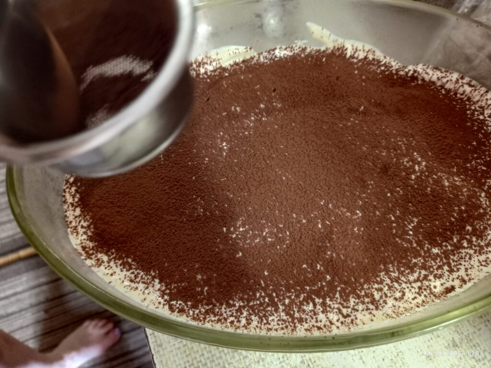

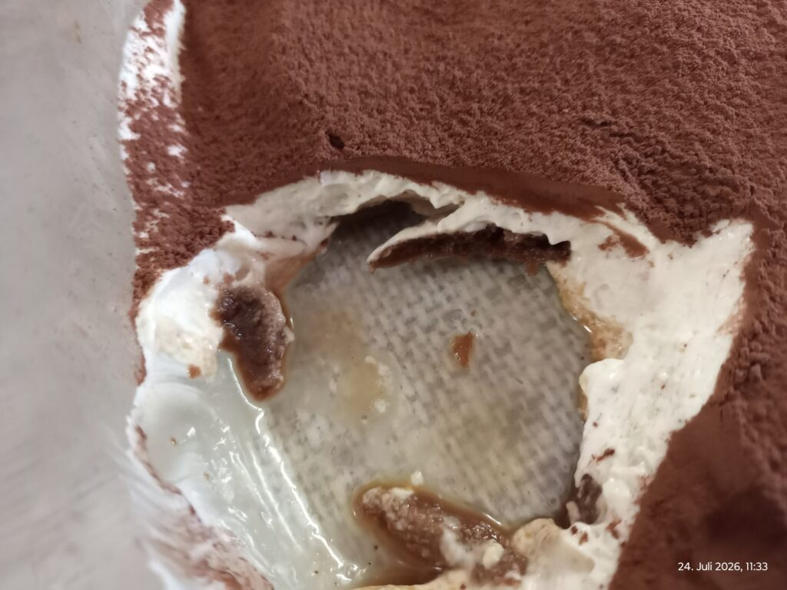
