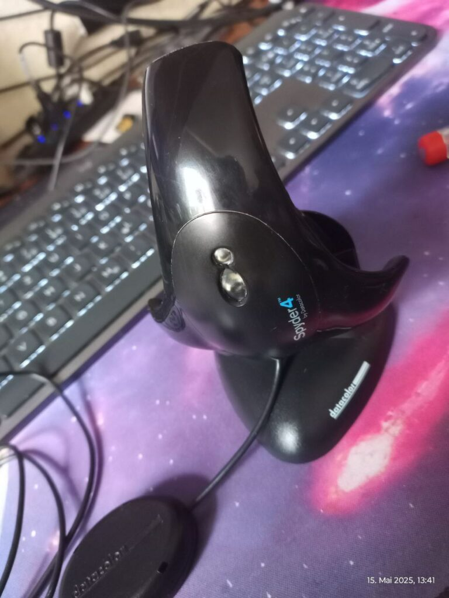
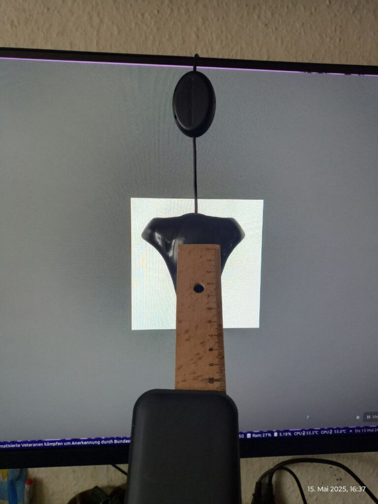
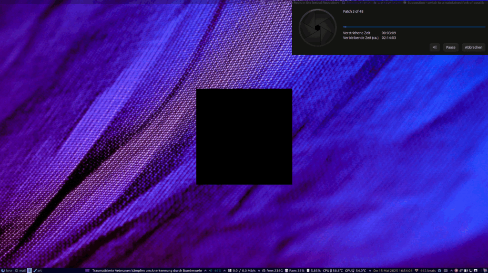
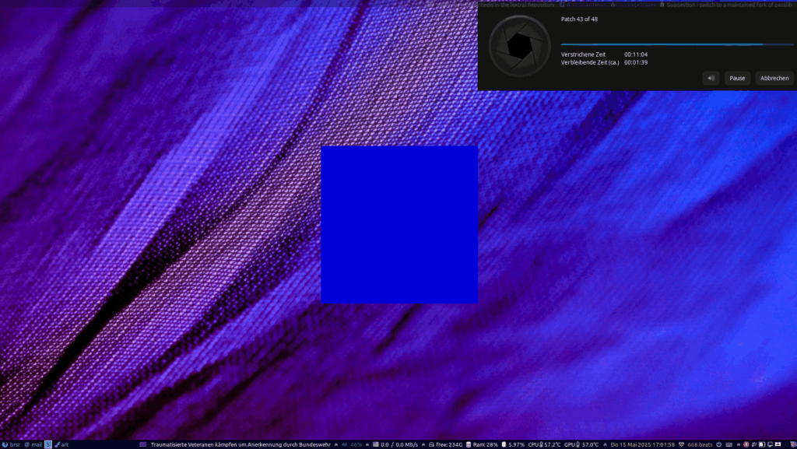
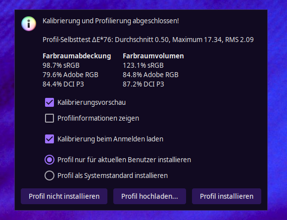
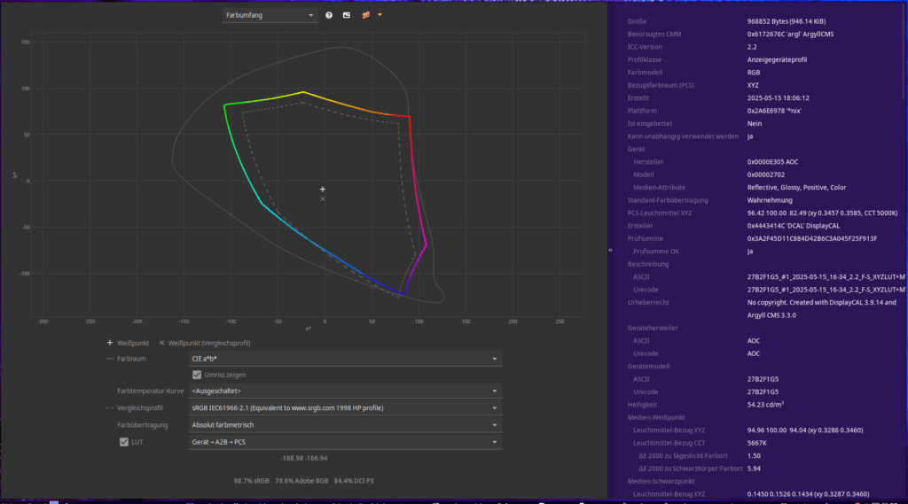
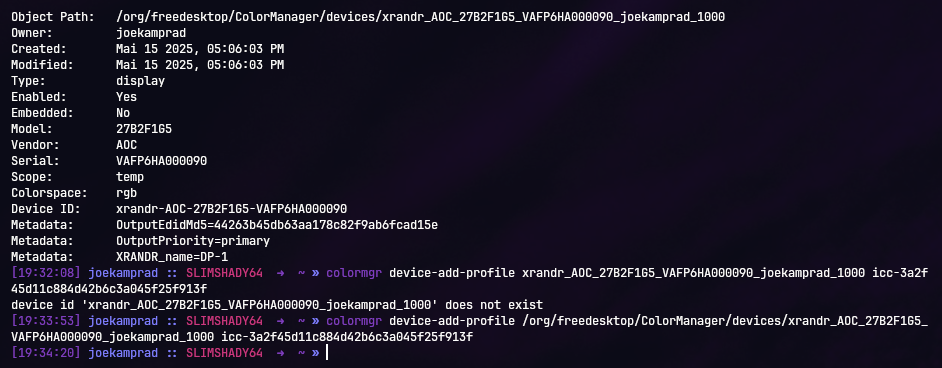

got this in the mail:

**Datacolor Spyder4**



```
Mai 15 13:37:42 SLIMSHADY64 kernel: usb 3-4.1: new full-speed USB device number 7 using xhci_hcd
Mai 15 13:37:42 SLIMSHADY64 kernel: usb 3-4.1: New USB device found, idVendor=085c, idProduct=0400, bcdDevice= 1.07
Mai 15 13:37:42 SLIMSHADY64 kernel: usb 3-4.1: New USB device strings: Mfr=1, Product=2, SerialNumber=0
Mai 15 13:37:42 SLIMSHADY64 kernel: usb 3-4.1: Product: Datacolor Spyder4
Mai 15 13:37:42 SLIMSHADY64 kernel: usb 3-4.1: Manufacturer: Datacolor
```

seems to work and gots detected properly.. but optics looks blurry..

Okay let's start calibrating, but it misses what gives him the name… the spider to fix it on the screen .. i need to fix that first and ask the guy selling it…



okay this does the trick ;)









It was running for over an hour to get the Data.. more like 1 1/2 hours.

[Measurement_Report_3_9_14_27B2F1G5_1920_0_1920x1080_2025-05-15](/files/Measurement_Report_3_9_14_27B2F1G5_1920_0_1920x1080_2025-05-15_18-36.html)

➜ ~ » colormgr get-profiles`

```
Object Path: /org/freedesktop/ColorManager/profiles/icc_3a2f45d11c884d42b6c3a045f25f913f_joekamprad_1000
Owner: joekamprad   Format: ColorSpace..   Title: 27B2F1G5 #1 2025-05-15 16-34 2.2 F-S XYZLUT+MTX
Qualifier: RGB..
Type: display-device
Colorspace: rgb
Scope: temp
Gamma Table: Yes
System Wide: No
Filename: /home/joekamprad/.local/share/icc/27B2F1G5_#1_2025-05-15_16-34_2.2_F-S_XYZLUT+MTX.icc
Profile ID: icc-3a2f45d11c884d42b6c3a045f25f913f
Metadata: GAMUT_coverage(dci-p3)=0.8441
Metadata: Quality=high
Metadata: EDID_green_x=0.314453125
Metadata: EDID_blue_y=0.0751953125
Metadata: DATA_source=calib
Metadata: ACCURACY_dE76_max=17.344254
Metadata: EDID_mnft_id=1507
Metadata: CMF_version=3.9.14
Metadata: EDID_serial=VAFNBHA005533
Metadata: MAPPING_device_id=xrandr-AOC-27B2F1G5-VAFNBHA005533
Metadata: GAMUT_coverage(srgb)=0.9865
Metadata: EDID_blue_x=0.1484375
Metadata: EDID_white_y=0.3291015625
Metadata: CMF_binary=DisplayCAL
Metadata: EDID_white_x=0.3134765625
Metadata: EDID_model_id=9986
Metadata: prefix=b'EDID_,CMF_,DATA_,MEASUREMENT_,OPENICC_,MAPPING_,ACCURACY_,GAMUT_'
Metadata: EDID_red_y=0.3310546875
Metadata: License=Public Domain
Metadata: EDID_gamma=2.2
Metadata: EDID_mnft=AOC
Metadata: MEASUREMENT_device=spyder4
Metadata: CMF_product=DisplayCAL
Metadata: ACCURACY_dE76_rms=2.089371
Metadata: ACCURACY_dE76_avg=0.495734
Metadata: OPENICC_automatic_generated=0
Metadata: EDID_red_x=0.6513671875
Metadata: GAMUT_volume=1.2312507093134208
Metadata: EDID_model=27B2F1G5
Metadata: GAMUT_coverage(adobe-rgb)=0.7959
Metadata: EDID_green_y=0.6142578125
Metadata: EDID_manufacturer=AOC
Metadata: EDID_date=2022-T48
Metadata: EDID_md5=8fbd5c0a4b09f12a23c7afb86582c49f
Metadata: FILE_checksum=3a2f45d11c884d42b6c3a045f25f913f
Warning: gray-axis-invalid
```

DisplayCal offers the option to apply the created profile directly:

[https://wiki.archlinux.org/title/ICC\_profiles#xiccd](https://wiki.archlinux.org/title/ICC_profiles#xiccd)

I need to see how i can apply noto second display:

`Metadata: MAPPING_device_id=xrandr-AOC-27B2F1G5-VAFNBHA005533`

It shows for the one it applies but second one (same device) seems not to be added..



easy ;)

[Here the created icc file:](/files/27B2F1G5_1_2025-05-15_16-34_2.2_F-S_XYZLUT+MTX.icc)
