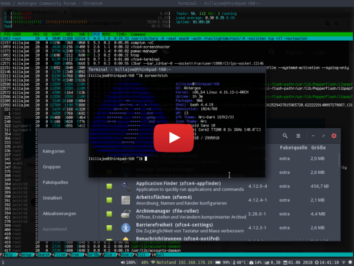
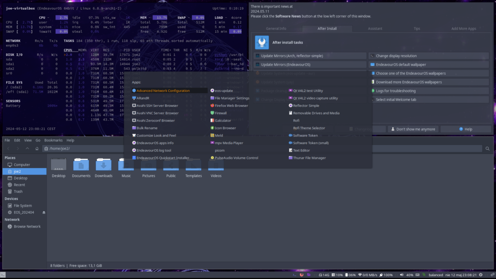
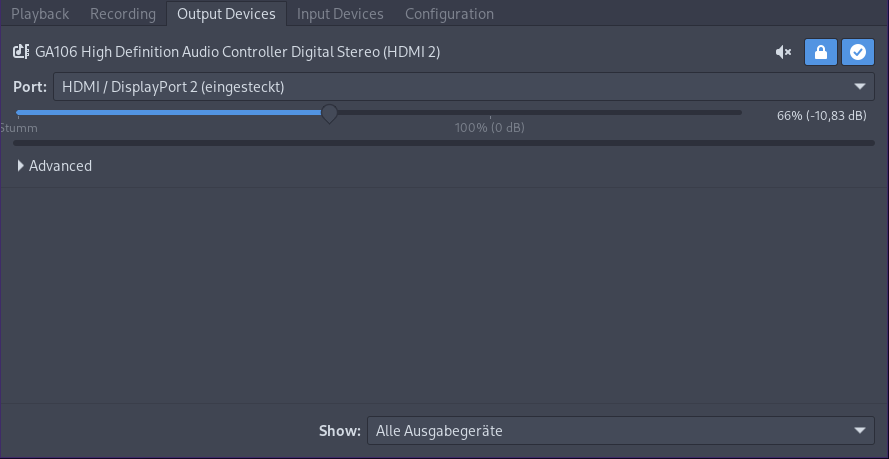

[https://github.com/endeavouros-team/endeavouros-i3wm-setup](https://github.com/endeavouros-team/endeavouros-i3wm-setup)

Since January 31, 2021, I do maintain and develop the [i3wm](https://i3wm.org/) setup used on the [EndeavourOS ISO](https://github.com/endeavouros-team/EndeavourOS-ISO)

To be honest ... it starts earlier already while still helping on [Antergos](https://en.wikipedia.org/wiki/Antergos) in [Jun 1, 2018:](https://github.com/killajoe/i3-antergos/commit/de70292912ec17db59176baa5b62af858dadaca0)

[https://github.com/killajoe/i3-antergos](https://github.com/killajoe/i3-antergos)

The main reason is that I do use i3 as the base of my personal Desktop for a very long time already.

From that knowledge I had the idea to set up a basic simple setup with nicely documented config files for users to start tinkering with i3wm. What starts getting into the EndeavourOS ISO is not really that minimal of a setup, more like a Desktop build with i3wm.

As of April 2024 it has 409 stars and 109 forks on [GitHub](https://github.com/endeavouros-team/endeavouros-i3wm-setup) ! And is a widely loved and used variant users take to install EndeavourOS.

We can see 33 contributors [https://github.com/endeavouros-team/endeavouros-i3wm-setup/graphs/contributors](https://github.com/endeavouros-team/endeavouros-i3wm-setup/graphs/contributors) that's something making me proud and feeling honored!

Starting as a small idea, it has grown to a useful startup for users searching to try something different.

It would not be what it is today, without all the help, hints, ideas and contributions added by users.

A huge thanks to all of you!

## I will use this to share some news about the setup in the future, like now some changes on Rofi:

#### Rofi Menus now have changeable Color schemes/Themes \[13.Mai 2024\]

Up from package Version 2.1 [https://github.com/endeavouros-team/endeavouros-i3wm-setup/releases/tag/2.1](https://github.com/endeavouros-team/endeavouros-i3wm-setup/releases/tag/2.1) you can change the colors for all EndeavourOS i3wm [Rofi](https://davatorium.github.io/rofi/) menu apps:

- dmenu (Desktop App menu)

- powermenu (logout reboot hibernate menu)

- powersaving menu (power-profiles-daemon profile switcher)

- keyhint keybind menu (F1 menu)

https://youtu.be/usH75TroeSE?si=odazMkD341dm3YC6

## Very little change to dunst (notifier) \[18. Mai 2024\]

\# Display indicators for URLs (U) and actions (A).  
  
As of why ? Always looks like this "indicators" are replacements for missing icons or something...

[https://github.com/endeavouros-team/endeavouros-i3wm-setup/commit/038bc28179526da1cb84671fed3963d827e17248](https://github.com/endeavouros-team/endeavouros-i3wm-setup/commit/038bc28179526da1cb84671fed3963d827e17248)

### Merge pull request [#118](https://github.com/endeavouros-team/endeavouros-i3wm-setup/pull/118) from CoutHi/new\_branch \[30 Mai 2024\]

Thanks to [CoutHi](https://github.com/CoutHi) contributing a fix for playerctl pause and play not working  
  
[https://github.com/endeavouros-team/endeavouros-i3wm-setup/commit/4d7ed615c78c6af495c15f5eb3c9267f89a0e22c](https://github.com/endeavouros-team/endeavouros-i3wm-setup/commit/4d7ed615c78c6af495c15f5eb3c9267f89a0e22c)

### [Prathamesh](https://github.com/tur1ngb0x) hints me on some format issues with the README files and some improvements for the information given there \[01 June 2024\]

[https://github.com/endeavouros-team/endeavouros-i3wm-setup/pull/119](https://github.com/endeavouros-team/endeavouros-i3wm-setup/pull/119)

[https://github.com/endeavouros-team/endeavouros-i3wm-setup/pull/120](https://github.com/endeavouros-team/endeavouros-i3wm-setup/pull/120)

This was yesterday indeed .. today he suggests some more fixes and i applied them on to the README together with changing from lxappearance to [nwg-look](https://github.com/nwg-piotr/nwg-look) as used theme changer gui app .. and adding gtk-theme settings.ini for gtk4 as of [pavucontrol](https://freedesktop.org/software/pulseaudio/pavucontrol) is now on libadwaita and was no longer following the set gtk theme.

### Rewriting some scripts to simplify and make them more minimal \[Sep 23, 2025\]

[audio-device-switch](https://github.com/endeavouros-team/endeavouros-i3wm-setup/commit/e14457549959a15b5671353e4d9605ef79745ca0): added switcher to simply switch audio output devices on the fly over keystroke

[openweather](https://github.com/endeavouros-team/endeavouros-i3wm-setup/blob/main/etc/skel/.config/i3/scripts/openweather): completely rewritten

[powermenu](https://github.com/endeavouros-team/endeavouros-i3wm-setup/blob/main/etc/skel/.config/i3/scripts/powermenu): rewritten too, removed zenity support now rofi only, better options for lock integrated.

[volume\_brightness.sh](https://github.com/endeavouros-team/endeavouros-i3wm-setup/blob/main/etc/skel/.config/i3/scripts/volume_brightness.sh): changed to use brightnessctl \[xbacklight is non functional on modern hardware\]

[power-profiles](https://github.com/endeavouros-team/endeavouros-i3wm-setup/blob/main/etc/skel/.config/i3/scripts/power-profiles): better scripting here too and fixing rofi part.

Plus reviewing other scripts, and the i3-blocks setup, and i3 config to cleanup and format fixes.

And i love to see a bunch of users pull requesting fixes for small and bigger things!

You make this setup alive!

- [https://github.com/endeavouros-team/endeavouros-i3wm-setup/commit/9e87c38301a93988d55ad95ae5c5d0527d4f2af6](https://github.com/endeavouros-team/endeavouros-i3wm-setup/commit/9e87c38301a93988d55ad95ae5c5d0527d4f2af6)

- [https://github.com/endeavouros-team/endeavouros-i3wm-setup/commit/57efe732f84822f589743d56ed2f47c0af178dd8](https://github.com/endeavouros-team/endeavouros-i3wm-setup/commit/57efe732f84822f589743d56ed2f47c0af178dd8)

- [https://github.com/endeavouros-team/endeavouros-i3wm-setup/commit/5adbcc106b8b30f853ca039ad3839b7d7b6bfc78](https://github.com/endeavouros-team/endeavouros-i3wm-setup/commit/5adbcc106b8b30f853ca039ad3839b7d7b6bfc78)

- [https://github.com/endeavouros-team/endeavouros-i3wm-setup/commit/7e0e2162d2464a6d0f8ff92d1c22cec9a8d16b23](https://github.com/endeavouros-team/endeavouros-i3wm-setup/commit/7e0e2162d2464a6d0f8ff92d1c22cec9a8d16b23)

- [https://github.com/endeavouros-team/endeavouros-i3wm-setup/commit/c158cc9180f66bbab32f45aca041639bad61f5b2](https://github.com/endeavouros-team/endeavouros-i3wm-setup/commit/c158cc9180f66bbab32f45aca041639bad61f5b2)

- [https://github.com/endeavouros-team/endeavouros-i3wm-setup/commit/0d396d9b9a0bcc21b5372e820d0b7fde44bd63b2](https://github.com/endeavouros-team/endeavouros-i3wm-setup/commit/0d396d9b9a0bcc21b5372e820d0b7fde44bd63b2)

- [https://github.com/endeavouros-team/endeavouros-i3wm-setup/commit/d389f9fcb0fea393d8dbe13dc46c0055a70e84aa](https://github.com/endeavouros-team/endeavouros-i3wm-setup/commit/d389f9fcb0fea393d8dbe13dc46c0055a70e84aa)

- [https://github.com/endeavouros-team/endeavouros-i3wm-setup/commit/d807b41b7f35047655892c63c0922a1f474634a4](https://github.com/endeavouros-team/endeavouros-i3wm-setup/commit/d807b41b7f35047655892c63c0922a1f474634a4)

- [https://github.com/endeavouros-team/endeavouros-i3wm-setup/commit/22c47613ff4cc0f82d52ab9e48d04a20bf8e9ddc](https://github.com/endeavouros-team/endeavouros-i3wm-setup/commit/22c47613ff4cc0f82d52ab9e48d04a20bf8e9ddc)

- [https://github.com/endeavouros-team/endeavouros-i3wm-setup/commit/7be3b83f38599147d88c4e370754c644415ed689](https://github.com/endeavouros-team/endeavouros-i3wm-setup/commit/7be3b83f38599147d88c4e370754c644415ed689)

- [https://github.com/endeavouros-team/endeavouros-i3wm-setup/commit/08c96fae915c69e12f038473c994baf4e3a41379](https://github.com/endeavouros-team/endeavouros-i3wm-setup/commit/08c96fae915c69e12f038473c994baf4e3a41379)
