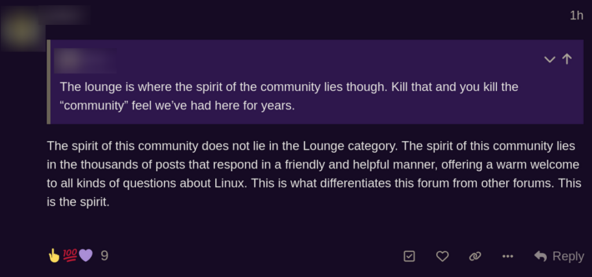

Thoughts and Thinking on EndeavourOS

**Forum**: [https://forum.endeavouros.com](https://forum.endeavouros.com/)[/](https://forum.endeavouros.com/)

**Website**: [https://endeavouros.com/](https://endeavouros.com/)

**Development**: [https://github.com/endeavouros-team](https://github.com/endeavouros-team)

**Beta-Testing:** [https://github.com/endeavouros-team/development-iso-testing](https://github.com/endeavouros-team/development-iso-testing)

**History:** [https://youtu.be/E3spnr4G8yI?si=6pzui9PatKT9X4OL](https://youtu.be/E3spnr4G8yI?si=6pzui9PatKT9X4OL)

https://youtu.be/E3spnr4G8yI?si=6pzui9PatKT9X4OL

Some of my thinking and ideas for [EnOS](https://www.endeavouros.com) will be here shortly:

## #Why we do endeavour to create and maintain EndeavourOS at all?

The EndeavourOS Team is developing EndeavourOS out of a passion for creating a Linux distribution that empowers users to truly understand and control their system. EndeavourOS was born from the idea that simplicity, transparency, and learning should be at the heart of a modern operating system. Instead of hiding the inner workings behind automation or overwhelming users with unnecessary complexity, the team aims to bridge the gap between approachability and technical depth.

As experienced Linux users and community builders, the EndeavourOS Development Team recognized that many people wanted the flexibility and performance of Arch Linux but were intimidated by its steep learning curve. EndeavourOS provides a smart middle ground — an Arch-based system that remains close to upstream while offering An accessible installer, sensible defaults, and a welcoming community. The team’s development philosophy centers on enabling users to grow their skills. Every tool and script is designed to be open, understandable, and optional, encouraging exploration rather than dependency. Following the idea to give the info on how things work with tutorials instead of setting up everything everyone could need one day by default. Giving a blanc canvas to start customizing the OS and Desktop to your personal needs.

Beyond technical goals, the EndeavourOS Development Team is driven by a strong sense of community and collaboration. **EndeavourOS is not a product** — it’s a collective effort of enthusiasts who share knowledge and improve the project together. The developers nurture this environment by maintaining transparency in decisions, valuing user feedback, and keeping the project free of corporate influence.

Ultimately, the EndeavourOS Development Team develops EndeavourOS to keep the spirit of Linux alive: curiosity, freedom, and self-reliance. Through their work, they give both newcomers and experienced users a platform to learn, customize, and take full ownership of their systems — turning the Distribution into a shared journey of discovery, empowerment and endevour!

https://www.kamprad.net/index.php/2026/05/03/endeavouros-enabled/

## [#Forum/Community/Politics \[February 2026\]](#Forum-Community-Politics)

One day it simply started: users in the forum began arguing about various topics. In some cases, there was always someone who stubbornly insisted on their opinion... regardless of whether it was right or wrong.

It happens, we thought. And we tried to handle it.

Many hours were spent reading back and forth through endless threads. We told ourselves it was just one of those things. But it did not stop. It kept happening. It was always the same individuals triggering the same cycle over and over again.

I can tell you: that has nothing to do with fun... especially when you are doing all of this in your free time. The time when you should be relaxing, meeting friends, or discussing interesting topics with your online community. **Never politics**.

We do not want anything to do with that... unless it directly affects the community or the use of a free operating system.

And it was not only politics. These same people managed to turn almost every topic, no matter what it was about, into personal attacks. A twilight of the gods? At times, it felt exactly like that. When individuals elevate themselves and place their opinions and attitudes above everyone else, it becomes a problem for any community.

Everyone is entitled to their own opinion and can pursue happiness in their own way. There is no need to attack others. You can simply agree to disagree. That is enough. You can do that too.

Still, we thought it would settle down on its own. We were wrong. It did not stop. Eventually, it became so frustrating that we had to draw a clear line.

This led to a fundamental restructuring and a clear focus on Linux-related topics. At the same time, there remains the intention to keep space for conversations about everyday matters. A bit of beer and schnapps is part of it, and a little spice can go a long way.

This is not about condemning, excluding, or censoring anyone. It is about restoring the sense of enjoyment... and moving forward.

And no its not about this one incident, nor about the users who were involved in this one case.

It is about the future of the community and the spirit that the founders of this project carry in their hearts and also all of you here.

And no not about guilt, we are here to get help, and help others in a friendly environment, regardless of their level of experience, and to have a good time in between, but not to sacrifice time and money to offer others a stage for whatever they try to spread into the world outside the known purple universe.

What I find alarming... something I see again every day... is that people often don’t actually read the article itself. Instead, they draw all their information and opinions from the title alone. In many cases, even the title is misunderstood. For example, instead of reading _“Will the lounge be removed entirely? The answer is: no, it won’t,”_ some people interpret it as _“The lounge will be removed entirely! The answer is: yes, it will.”_  
The article itself clearly explains that this is **not** the case, and that the change is simply a restructuring.

However, judging from the responses, many still assume everything will be deleted. People shout “Censorship! Censorship!”, others ask what reason they would have to stay in the forum if there were no lounge anymore (you might want to ask yourself why that is 😉). The same questions keep coming up — why not simply add more moderators, or claims that it isn’t obvious these threads have turned into political battleground discussions.

But that’s exactly the point: **it is being moderated**, and **we are actively taking care of the community**.

We just don't want to have anything to do with this stuff and certainly don't want to spend our free time dealing with self-proclaimed gods, this stuff is already smeared everywhere anyway, there is still enough great, beautiful, interesting, fantastic stuff that we can talk about in a friendly way.



[Source: EndeavourOS Forum](https://forum.endeavouros.com/t/will-the-lounge-be-removed-entirely-the-answer-is-no-it-wont/78094/40?u=joekamprad)

I know, I know, this will slap some (few) in the face, but it is what it is, we just want to keep our fun, and as always:

> **one man's freedom is always in addition, another man's freedom**.

## **#AUR RAT / security?**

[https://news.itsfoss.com/arch-linux-spark-rat](https://news.itsfoss.com/arch-linux-spark-rat)

[https://linuxsecurity.com/features/chaos-rat-in-aur](https://linuxsecurity.com/features/chaos-rat-in-aur)

[https://www.reddit.com/r/cybersecurity/comments/1m3r2mo/arch\_linux\_pulls\_aur\_packages\_that\_installed/?tl=de](https://www.reddit.com/r/cybersecurity/comments/1m3r2mo/arch_linux_pulls_aur_packages_that_installed/?tl=de)

[https://forum.endeavouros.com/t/more-rats-found-in-aur/73963?page=2](https://forum.endeavouros.com/t/more-rats-found-in-aur/73963?page=2)

I mean yes EndeavourOS delivers OS installs with yay installed by default, thats a very two sided sword.

On one hand we are not responsible for the [AUR](https://aur.archlinux.org/) and we do not install builds from the AUR by default, we have some packages in the repo we do take from [AUR](https://aur.archlinux.org/) but the process is controlled by humans.

Any user should get informed about the AUR before going to use it, but.. i do see new users not having a clue about what even is a [Repo-Package](https://archlinux.org/packages/) or a [PKGBUILD](https://wiki.archlinux.org/title/PKGBUILD). Using yay and searching for names and installing something not knowing what is happen at all while doing this. We could indeed remove yay from getting installed or put a portal on usage:

People simple do not read, and do not get the info. Not much we can do about.

A lot of users know what they are doing on EndeavourOS and it would annoy these staples if we add portal or remove things only to benefit the stupids ;)

Personal i like the Portal idea, lets see if it will happen.. I start with adding a scriptlet to .bashrc this is easy to remove in case you do not want it.

```bash title="~/.bashrc" frame="terminal"
#
# ~/.bashrc
#

# If not running interactively, don't do anything
[[ $- != *i* ]] && return

alias ls='ls --color=auto'
alias grep='grep --color=auto'
PS1="[\[\e[35m\]\u\[\e[m\]\[\e[31m\]@\[\e[m\]\[\e[34m\]\h\[\e[m\]]\\$\[\e[33m\]\w\[\e[m\]\[\e[36m\]:\[\e[m\] "
#PS1='[\u@\h \W]\$ '

bind '"\e[A":history-search-backward' # history with arrow up key
bind '"\e[B":history-search-forward' # history with arrow down key

export PATH=$PATH:~/.local/bin

yay() {
    # Red, bold "WARNING" heading
    echo -e "\e[1;31m\e[1mWARNING\e[0m" >&2
    echo -e "\e[0;33mYou use yay, which allows you to build and install AUR packages.\e[0m" >&2
    echo -e "\e[0;33mAUR packages are user-produced content.\e[0m" >&2
    echo -e "\e[0;33mThese PKGBUILDs are completely unofficial and have not been thoroughly vetted.\e[0m" >&2
    echo -e "\e[0;33mAny use of the provided files is at your own risk.\n\e[0m" >&2
    read -rp "Do you want to continue? (y/N): " confirm
    if [[ "$confirm" =~ ^[Yy]$ ]]; then
        /usr/bin/yay "$@"
    else
        echo "Aborted."
        return 1
    fi
}
```

## **#Archlinux a collaborative pirate ship?**

We do collaborate with all the different Distros also are on the same boat, there is collaboration on Distros using Calamares, and we do have Collaboration with other ARCH -Based Distros, it is one of our core ideas to collaborate.

But it is true that forces could be bundled in a much more collaborative way, but as all of them mainly started and running as personal projects, and holden together a bigger Group of Developers and Maintainers would need another structure, then relay on one Persons Character only.

Working together on a bigger Project with bundled powers will need money to pay contribution time for the ones in a leading position, as it will need some full-time Developers/Leaders to hold it all together.

And yes I do think this could be possible in the future, more and more younger people will go another way on building business, something with meaning and not with the goal of maximizing profit but with the goal of doing something for the community.

## **#influx-growing-trolls-community**

Lately some _green tornado_ happen somewhere on another Distro, a lot users screaming into EndeavourOS Forum:

[https://forum.endeavouros.com/t/stability-vs-manjaro](https://forum.endeavouros.com/t/stability-vs-manjaro)

[https://forum.endeavouros.com/t/whats-the-difference-between-endeavouros-and-manjaro](https://forum.endeavouros.com/t/whats-the-difference-between-endeavouros-and-manjaro)

[https://forum.endeavouros.com/t/little-things-the-ex-manjaro-user-needs-to-know-d](https://forum.endeavouros.com/t/little-things-the-ex-manjaro-user-needs-to-know-d)

[https://forum.endeavouros.com/t/what-do-former-manjaro-users-like-about-eos](https://forum.endeavouros.com/t/what-do-former-manjaro-users-like-about-eos)

[https://forum.endeavouros.com/t/manjaro-to-endeavouros-experiences](https://forum.endeavouros.com/t/manjaro-to-endeavouros-experiences)

[https://forum.endeavouros.com/t/why-choose-endeavouros-over-manjaro/](https://forum.endeavouros.com/t/why-choose-endeavouros-over-manjaro/)

For a week it was looking like a storm of Grasshoppers taking over the friendly EndeavourOS-communities living room with a lot of unfriendly and disturbing actions.. But the team of moderators was on the track, we have some conversation about what we can do to calm that down.

And "wahu" it was working! A great team of people knowing only from virtual communication start working together and bring back that positive vibe to the forum!

The reason to start EndeavourOS was exactly that a friendly welcoming community, with users from all states on Linux to help each other and having fun while doing that.

Thanks all you strangers at the Forum Moderators Group! If it stays like that i am happy do be part of that, more then before.

**[Friede Freude and Eierkuchen](https://en.wikipedia.org/wiki/Love_Parade) for all of you!**

https://youtu.be/3LbeAJh0vSU

## #VIBES

## #ARE

## #POSITIVE!

Our Forum at [https://forum.endeavouros.com](https://forum.endeavouros.com) is what we are at our core, a positive vibed community with a fantastic group of moderators, and a core team behind this knitting everything together!

And sure... there is our installer, for an easy install, developed by 4 Ex-Moderators from Antergos forum... and yes we are acknowledged on some coding and on Archlinux too but we are still Rookies on what we are doing with ArchISO and calamares, it will sometimes open a rabbit hole, and on others showing a better paved road … 

So question netinstall? yes we went into a rabbit hole, but we get back to what is our goal "KEEP IT SIMPLE!" and yes we simply come back out of the Rabbit Hole and back to a paved road to launch the netinstaller asap!

This will a fire-in-the-hole test:

involved shutting down the descent rocket, blowing the bolts that attached the ascent and descent stages, switching control and power to the ascent stage, and igniting the ascent rocket while still nestled to the landing stage... Source: [en.wikipedia.org](https://en.wikipedia.org/wiki/Fire_in_the_hole)

We do **endeavour** for you!

_This Linux (EndeavourOS)  is utterly unapologetic in catering to technology hobbyists, enthusiasts, and power users. It’s for the amateurs, in that best and most original sense of the word—those who love what they do. Awesome. So isn’t Endeavour the perfect name?_

_Source_: [opensource.com](https://opensource.com/article/19/11/emerging-projects)

## Universal EndeavourOS ISO

sa\_28\_mär\_2020

Development testing a new ISO which can boot on Nvidia propritary Drivers or Nouveau (OpenSource) from the same ISO!

So that users with very new Nvidia GPU's can use Nvidia boot option to be able to boot, and also older GPU's  (legacy Nvidia) will be able to boot.

https://youtu.be/HYuskoZthAU
