## [**Framework 13 AMD DYI AMD Ryzen™ 7 7840U**](https://frame.work/laptop13?tab=specs&slug=laptop-diy-13-gen-amd)


Simple setup default plasma/KDE

Encrypted using ext4 // and [**plymouth**](https://wiki.archlinux.org/title/Plymouth) for fancy passphrase prompt. You can find a fitting EndeavourOS logo under:

`/usr/share/pixmaps/endeavouros-logo-text-dark.png`

Just in case i created a fully dump package that will handle adding the boot animation and enable plymouth:

[https://github.com/killajoe/eos-bgrt](https://github.com/killajoe/eos-bgrt)

## General Things

- With **[Fwupd](https://wiki.archlinux.org/title/Fwupd)** you can simply update the UEFI Firmware on the device

- Sleep and Hibernate, working out of the box.

- All Hardware, including add-on cards, are working without the need for extra driver packages.

- **[Power-Profiles-Daemon](https://wiki.archlinux.org/title/CPU_frequency_scaling#power-profiles-daemon)** is good to go with it! No need for extra power saving options.

- **Kernel Boot options added:** `amdgpu.dcdebugmask=0x10 amdgpu.nopsr=1 rtc_cmos.use_acpi_alarm=1`

- fingerprint Sensor inside Power button is also working out of the box using **[Fprint](https://wiki.archlinux.org/title/Fprint)** With KDE (SDDM) you can set it easily to be used on login and sudo actions (read about the PAM settings with cause) **[https://wiki.archlinux.org/title/SDDM#Using\_a\_fingerprint\_reader](https://wiki.archlinux.org/title/SDDM#Using_a_fingerprint_reader)**

- It is getting hot on hard work… or if you use it on the sofa standing on soft surface, in case i make use of this what helps a ton: **[https://www.thingiverse.com/thing:6333364](https://www.thingiverse.com/thing:6333364)**

- RAM replaced with: [**CT16G56C46S5.M8G1**](https://www.crucial.com/memory/ddr5/CT2K16G56C46S5) **Crucial 32GB Kit (16GBx2) DDR5-5600 SODIMM**, This is on Frameworks [**compatibility list**](https://knowledgebase.frame.work/what-ram-memory-is-supported-in-framework-laptop-13-ryzen-7040-series-B1M60foth) Working perfectly [**details**](/files/framework-ram-info.html)

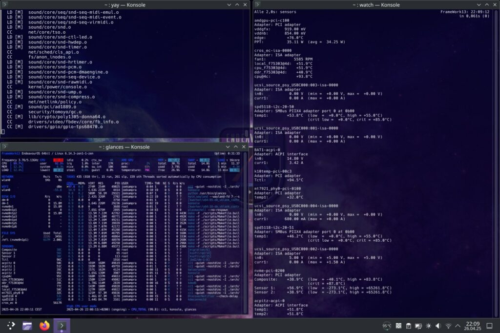

```
System:
Kernel: 6.14.3-zen1-1-zen arch: x86_64 bits: 64 compiler: gcc v: 14.2.1
Desktop: KDE Plasma v: 6.3.4 wm: kwin_wayland dm: SDDM
Distro: EndeavourOS
base: Arch Linux
Machine:  Type: Laptop System: Framework
product: Laptop 13 (AMD Ryzen 7040 Series)    v: A7
Mobo: Framework model: FRANMDCP07 v: A7
part-nu: FRANPGCP07 UEFI: INSYDE v: 03.07 date: 02/19/2025
Battery:  ID-1: BAT1
charge: 55.7 Wh (90.9%)
condition: 61.3/60.7 Wh (101.0%)
volts: 17.0 min: 15.5
model: NVT FRANGWA
status: dischargingCPU:
Info: 8-core model: AMD Ryzen 7 7840U w/ Radeon 780M Graphics bits: 64
type: MT MCP
arch: Zen 4 rev: 1 cache: L1: 512 KiB L2: 8 MiB L3: 16 MiB
Speed (MHz):
avg: 1100 min/max: 400/5134
boost: enabled
cores: 1: 1100 2: 1100 3: 1100 4: 1100 5: 1100 6: 1100 7: 1100 8: 1100 9: 1100 10: 1100 11: 1100 12: 1100 13: 1100 14: 1100 15: 1100 16: 1100
bogomips: 105400
Flags: avx avx2 ht lm nx pae sse sse2 sse3 sse4_1 sse4_2 sse4a ssse3 svm
Graphics:  Device-1: Advanced Micro Devices [AMD/ATI] Phoenix1 vendor: Framework    d
river: amdgpu v: kernel arch: RDNA-3 pcie: speed: 16 GT/s lanes: 16 ports:
active: eDP-1 empty: DP-1, DP-2, DP-3, DP-4, DP-5, DP-6, DP-7, DP-8,
Writeback-1 bus-ID: c1:00.0 chip-ID: 1002:15bf temp: 27.0 C
Device-2: Realtek Laptop Camera driver: uvcvideo
type: USB rev: 2.0
speed: 480 Mb/s
lanes: 1
bus-ID: 3-1:2
chip-ID: 0bda:5634
Display: wayland server: X.org v: 1.21.1.16 with: Xwayland v: 24.1.6
compositor: kwin_wayland driver: X: loaded: amdgpu
unloaded: modesetting,radeon alternate: fbdev,vesa dri: radeonsi
gpu: amdgpu display-ID: 0
Monitor-1: eDP-1 model: BOE Display 0x0bca res: 2256x1504 hz: 60 dpi: 201
diag: 343mm (13.5")  API: EGL v: 1.5 platforms: device: 0 drv: radeonsi device: 1 drv: swrast
gbm: drv: kms_swrast surfaceless: drv: radeonsi wayland: drv: radeonsi x11:
drv: radeonsi  API: OpenGL v: 4.6 compat-v: 4.5 vendor: amd mesa v: 25.0.4-arch1.1
glx-v: 1.4 direct-render: yes renderer: AMD Radeon 780M (radeonsi phoenix
LLVM 19.1.7 DRM 3.61 6.14.3-zen1-1-zen) device-ID: 1002:15bf
display-ID: :0.0  API: Vulkan v: 1.4.309 surfaces: xcb,xlib,wayland device: 0
type: integrated-gpu driver: mesa radv device-ID: 1002:15bf
Info: Tools: api: clinfo, eglinfo, glxinfo, vulkaninfo
de: kscreen-console,kscreen-doctor gpu: amdgpu_top wl: wayland-info
x11: xdpyinfo, xprop, xrandrAudio:
Device-1: Advanced Micro Devices [AMD/ATI] Rembrandt Radeon High Definition
Audio vendor: Framework driver: snd_hda_intel v: kernel pcie:
speed: 16 GT/s lanes: 16 bus-ID: c1:00.1 chip-ID: 1002:1640
Device-2: Advanced Micro Devices [AMD] ACP/ACP3X/ACP6x Audio Coprocessor
vendor: Framework driver: snd_pci_ps v: kernel pcie: speed: 16 GT/s
lanes: 16 bus-ID: c1:00.5 chip-ID: 1022:15e2
Device-3: Advanced Micro Devices [AMD] Family 17h/19h/1ah HD Audio
vendor: Framework driver: snd_hda_intel v: kernel pcie: speed: 16 GT/s
lanes: 16 bus-ID: c1:00.6 chip-ID: 1022:15e3
API: ALSA v: k6.14.3-zen1-1-zen status: kernel-api
Server-1: PipeWire v: 1.4.2 status: active with: 1: pipewire-pulse
status: active 2: wireplumber status: active 3: pipewire-alsa type: plugin
4: pw-jack type: pluginNetwork:
Device-1: MEDIATEK MT7922 802.11ax PCI Express Wireless Network Adapter
driver: mt7921e v: kernel pcie: speed: 5 GT/s lanes: 1 bus-ID: 01:00.0
chip-ID: 14c3:0616  IF: wlan0 state: up  IF-ID-1: virbr0 state: downBluetooth:
Device-1: MediaTek Wireless_Device driver: btusb v: 0.8 type: USB rev: 2.1
speed: 480 Mb/s lanes: 1 bus-ID: 1-5:3 chip-ID: 0e8d:e616
Report: btmgmt ID: hci0 rfk-id: 2 state: down bt-service: enabled,running
rfk-block: hardware: no software: yes bt-v: 5.2 lmp-v: 11Drives:
Local Storage: total: 476.94 GiB used: 235.94 GiB (49.5%)
ID-1: /dev/nvme0n1 vendor: Western Digital model: WD PC SN740 SDDPNQD-512G
size: 476.94 GiB speed: 63.2 Gb/s lanes: 4 temp: 25.9 C
Partition:  ID-1: / size: 344.94 GiB used: 235.33 GiB (68.2%) fs: ext4 dev: /dev/dm-0    m
apped: luks-XXXSwap:  ID-1: swap-1 type: partition size: 14.79 GiB used: 0 KiB (0.0%) priority: -2
dev: /dev/dm-1 mapped: luks-XXXSensors:  System Temperatures: cpu: 28.4 C gpu: amdgpu temp: 27.0 CInfo:
Memory: total: 32 GiB note: est. available: 30.65 GiB used: 3.23 GiB (10.6%)
Processes: 337 Power: uptime: 3h 12m wakeups: 1 Init: systemd v: 257
default: graphical  Packages: 1476 pm: pacman pkgs: 1470 pm: flatpak pkgs: 6 Compilers:
clang: 19.1.7 gcc: 14.2.1 Shell: Bash v: 5.2.37 running-in: konsole    inxi: 3.3.38
```

`[inxi -Fxxc0z](https://www.kamprad.net/hardwareinfo/hardware.info) (fresh)`

## WIFI:

```
[joekamprad@FrameWork13]$~: inxi -NazNetwork: 
Device-1: MEDIATEK MT7922 802.11ax PCI Express Wireless Network Adapter   
driver: mt7921e v: kernel pcie: gen: 2 speed: 5 GT/s lanes: 1   
bus-ID: 01:00.0 chip-ID: 14c3:0616 class-ID: 0280
```

I do not have issue in general with the wifi but seems it does have a small power management issue so i try to disable that feature:

with [iw](https://archlinux.org/packages/core/x86_64/iw/) installed you can check if powersave mode is active:

`iw dev wlan0 get power_save`

`mkdir -p /etc/NetworkManager/conf.d/`

`sudo nano /etc/NetworkManager/conf.d/disable-wifi-powersave.conf`

adding this in the config:

`[connection]   wifi.powersave = 2`

and restart NetworkManager:

`sudo systemctl restart NetworkManager`

## Fingeprint sensor:

Working flawless using fprint

`sudo pacman -Syu --needed usbutils fprintd imagemagick`

My handy script to insert your fingeprints one by one and after one is validated it waits till you hit enter key:

`for finger in {left,right}-{thumb,{index,middle,ring,little}-finger}; do   echo "Enrolling $finger"   fprintd-enroll -f "$finger" "$USER"   sleep 1   fprintd-delete -f "$finger" "$USER" >/dev/null 2>&1   read -rp "Press Enter to continue…"   done`

to verify: `fprintd-verify`

With KDE/plasma you do not need anything setup, if you want something else, i suggest reading here:

[https://wiki.archlinux.org/title/Fprint](https://wiki.archlinux.org/title/Fprint)

For SDDM create this file:

```
/etc/pam.d/sddm
```

```
auth 			[success=1 new_authtok_reqd=1 default=ignore]  	pam_unix.so try_first_pass likeauth nullok
auth 			sufficient  	pam_fprintd.so
```

[**Hardwareinfo**](/files/framework13-amd-hardinfo2_report.html)

### batterylogs

As of what is the device consuming while on suspend and even hibernation is a very interesting stat.

**[https://github.com/lhl/batterylog](https://github.com/lhl/batterylog)**

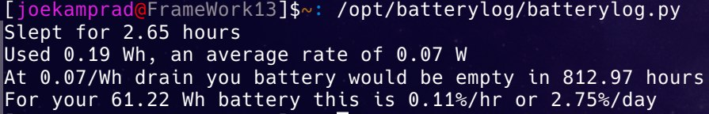
I will add more stats and info with time:

[**battery stat file**](/files/battery.stat)

This will get filled up automatically every time I log in the Framework 13 and write current battery stat. (open in new tab)

```
Give me feedback if you need more info on something
```

# Roll of changes and updates (issues improvements):

**11.08.2025:** Framework Laptop 13 System Firmware for AMD Ryzen 7040 Mainboards \[**0.0.3.9 --> 0.0.3.16**\]

Update AMD PI1.2.0.0c; Added Framework's dbx key and update Windows Secure Boot CA; Fixed hardware encryption on OPAL drives causes a missing boot drive issue on the next boot; Implement Battery Charge Limiting battery status; Implement the Framework EC device in BIOS;

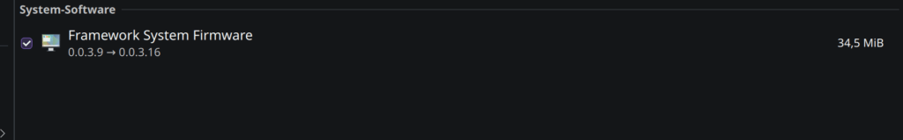

Let\`s reboot and check ;) --> all fine feels more slick .....

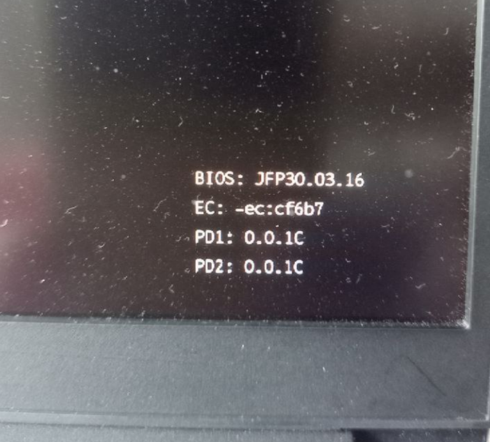

### opps.. hibernation stops working \[18.11.2025\]

Basically no clue if this is with last firware update or caused by kernel changes ?

hmm seems its working again with using:

`rtc_cmos.use_acpi_alarm=1`

as kernel parameter so all good lets try if close lid is also able to hibernate again now..

oh je no it is doing the same thing powerbutton is lighting aso keyboard LED but no display no keyboard.. strangely it seems the system is up and running as of i can ssh into the machine?

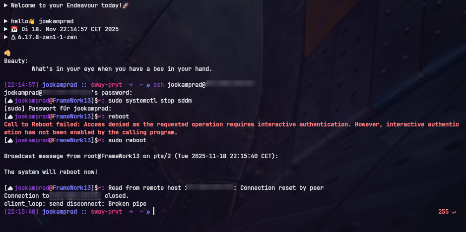

This makes me thinking its something with graphical? GPU.

From what i investigate its more about powerdevil, as on testing i was logging journalctl -f while closing and open lid, and it was properly getting the lid messages, but nothing from powerdevil.

So masking it:

`systemctl --user mask plasma-powerdevil.service`

and reboot to check if i can simply set it with systemd-logind

`/etc/systemd/logind.conf`

`HandleLidSwitch=hibernate   HandleLidSwitchDocked=hibernate`

renbooting again and yes its gone:

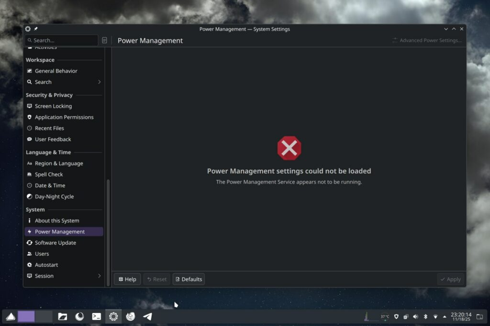

and lid close hibernate is working..

Not that i really like to now need to set all poweroprions up manually.

I will see if i can find a better way.

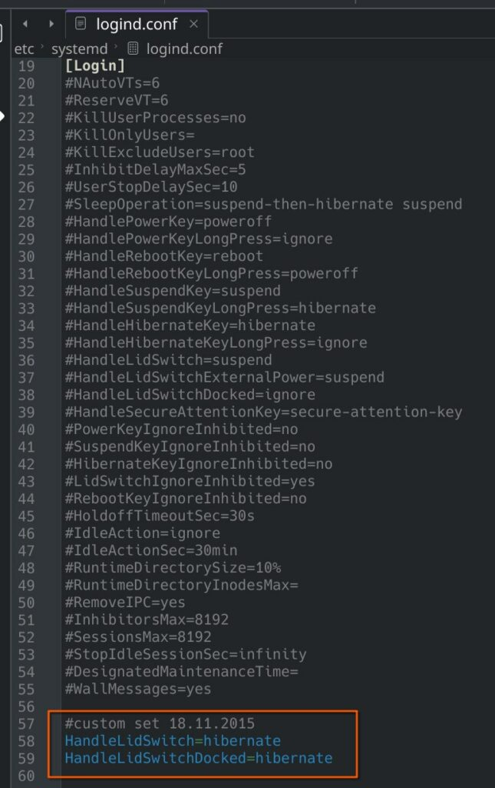

### Today 9th december 2025 the hibernation issue is still present:

But i do still not have the issue running sway nor using terminal commands still.

Firmware Systemupdate is available and installed, lets reboot to apply it and see

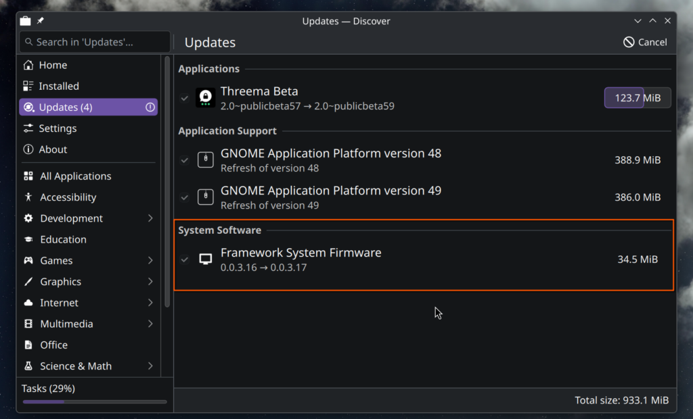

seems now i can use menu option to trigger hibernate, but lid-close is still failing the same way, on KDE/plasma ...

### Yesterday \[**15.12.2025**\] (_Bryans Birthday_)

i was installing Gnome on the Framework, and with this Hibernation is working Out-Of-The Box too ..

So it is really an issue with KDE/Plasma.

Still hope to get it back working one day ;)

### Christmas 2025 **\[25.12.2025\]**:

Playing with Hibernation on KDE Plasma 6 again, and seems i have some working configuration for now. Last cavbiat is that lid-close is stil not working, but having hibernate option from menu workingis abreeze laready!

Adding:

`amdgpu.gpu_recovery=1 amdgpu.dcdebugmask=0x10 amdrtc_cmos.use_acpi_alarm=1 amd_pstate=active`

to my \`/etc/kernel/cmdline\` and rebuild kernel images.. current Versions:

**linux-zen 6.18.2.zen2-1**

**mesa 1:25.3.2-1**

**xf86-video-amdgpu 25.0.0-1**

**plasma-workspace 6.5.4-1**

So we have a happy Christmas Joe to everyone!

Special to Framewoek for such an awesome machine i got from them!

Some logs from failed Hibernation usding lid close action:

[WARNING: CPU: 2 PID: 3702 at drivers/gpu/drm/amd/amdgpu/amdgpu\_irq.c:639 amdgpu\_irq\_put+0x144/0x170 \[amdgpu\] (click for full log)](https://endeavour.kamprad.net/pastebin/?04d1e60b2d5332db#81P1tchfBsUsZ5pV1Katfy89LsiXsAgGYkwJfWbDA7Dq)

[amdgpu crash (click for full log)](https://endeavour.kamprad.net/pastebin/?6b2309438e2a35b4#smrVipzhBxP1XMghTh2KpuPWjUMghp5NJoW1n4YN2Gs)

And mesa errors:

```
Dez 25 14:57:22 FrameWork13 kwin_wayland_wrapper[2576]: MESA: error: amdgpu: flags : 6
Dez 25 14:57:22 FrameWork13 kwin_wayland_wrapper[2576]: MESA: error: amdgpu: Failed to allocate a buffer:
Dez 25 14:57:22 FrameWork13 kwin_wayland_wrapper[2576]: MESA: error: amdgpu: size : 14278656 bytes
Dez 25 14:57:22 FrameWork13 kwin_wayland_wrapper[2576]: MESA: error: amdgpu: alignment : 2097152 bytes
Dez 25 14:57:22 FrameWork13 kwin_wayland_wrapper[2576]: MESA: error: amdgpu: domains : 4
Dez 25 14:57:22 FrameWork13 kwin_wayland_wrapper[2576]: MESA: error: amdgpu: flags : 6
```

`Dez 25 14:57:22 FrameWork13 kwin_wayland[2576]: Applying output configuration failed!`

Hibernation:

```
Dez 25 14:57:21 FrameWork13 kernel: PM: hibernation: hibernation exit
Dez 25 14:57:22 FrameWork13 kwin_wayland[2576]: Waiting for glGetGraphicsResetStatus to return GL_NO_ERROR timed out!
Dez 25 14:57:22 FrameWork13 kwin_wayland[2576]: 0x2: GL_CONTEXT_LOST in context lost
Dez 25 14:57:22 FrameWork13 systemd-sleep[7238]: Successfully thawed unit 'user.slice'.
Dez 25 14:57:22 FrameWork13 systemd[1]: session-4.scope: Unit now thawed.
Dez 25 14:57:22 FrameWork13 systemd[1]: session-2.scope: Unit now thawed.
Dez 25 14:57:22 FrameWork13 systemd[1]: systemd-hibernate.service: Main process exited, code=exited, status=1/FAILURE
Dez 25 14:57:22 FrameWork13 systemd[1]: systemd-hibernate.service: Failed with result 'exit-code'.
Dez 25 14:57:22 FrameWork13 systemd[1]: Failed to start System Hibernate.
Dez 25 14:57:22 FrameWork13 systemd[1]: Dependency failed for System Hibernation.
Dez 25 14:57:22 FrameWork13 systemd[1]: hibernate.target: Job hibernate.target/start failed with result 'dependency'.
Dez 25 14:57:22 FrameWork13 systemd[1]: systemd-hibernate.service: Consumed 1.151s CPU time over 1min 20.252s wall clock time, 8.8M memory peak.`
```

All looks really like issue with GPU/driver/modules ...

### January **\[28.1.2026\]**

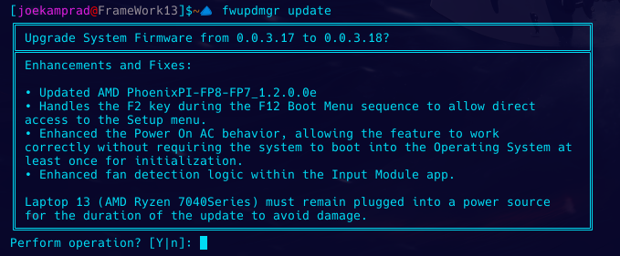

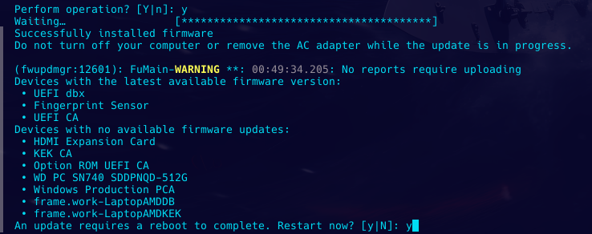

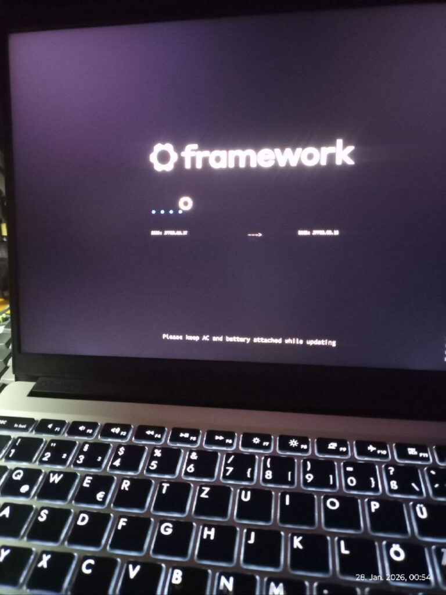

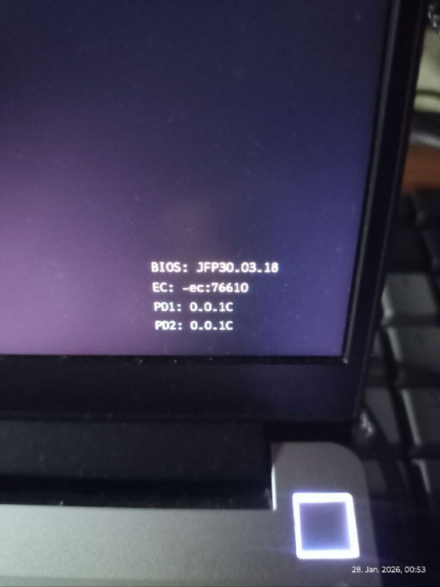


So lets check if the hiberantion issue is still present...

**Good news seems hibernate from lid close is working again after the update!**

And it was not like two hours before the update i tried it and it was failing the same!

🥳

## \[June 9th 2026\] - joe in vacation

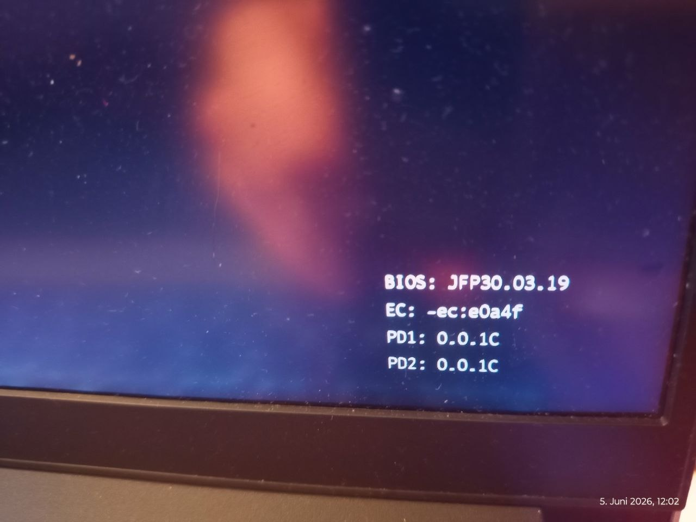
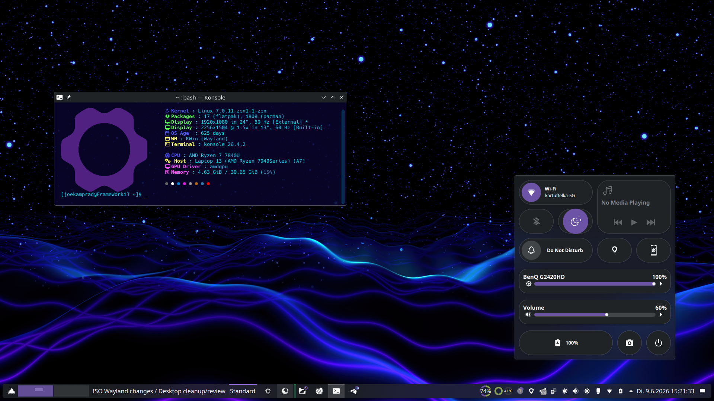
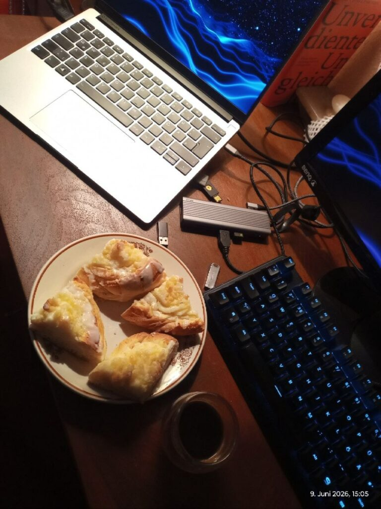

Absolutely loving it still, i can do everything when on the road, only best is to add a second display indeed..

Updated to latest Bios Version JFP30.03.19 no issues also do not see improvement at the moment but not checked the changelog too.. [https://community.frame.work/t/framework-laptop-13-ryzen-7040-bios-3-19-release-beta/82775](https://community.frame.work/t/framework-laptop-13-ryzen-7040-bios-3-19-release-beta/82775)
