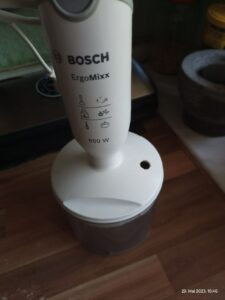
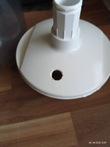
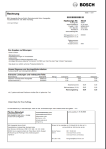
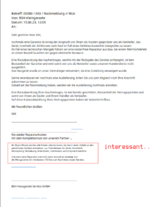
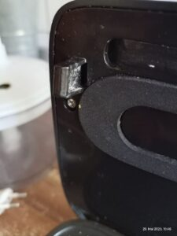
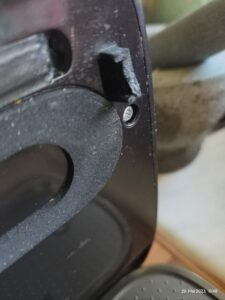
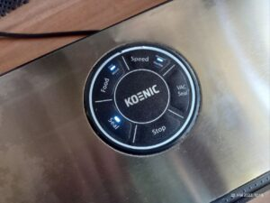
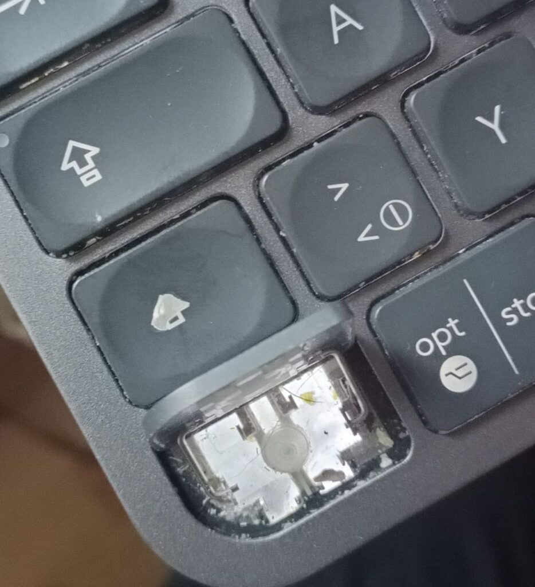

**Geplante Obsoleszenz, geplanter Verschleiß**, **Produktvergreisung,**  ist eine [Marketingstrategie](https://de.wikipedia.org/wiki/Marketingstrategie "Marketingstrategie"), bei der das Veralten eines Produktes ([Obsoleszenz](https://de.wikipedia.org/wiki/Obsoleszenz "Obsoleszenz")) vom Hersteller geplant und konzeptionell vorgesehen ist.

Geplante Obsoleszenz ist eine Strategie des Konstruierens von Produkten mit begrenzter Lebensdauer, damit der Kunde diese durch Neukauf ersetzen muss. Das Grundprinzip dieser Strategie besteht darin, langfristige das Absatzvolumen zu erhöhen, indem die Zeit zwischen wiederholten Käufen verkürzt wird.

**Hier einige Produkte und deren Firmen bei dennen ich exakt das feststellen musste.**

**1\. [Krups](https://de.wikipedia.org/wiki/Krups):**

Ja Krups eigentlich genau .. Inbegriff "Deutscher Wertarbeit" ??

https://www.reddit.com/r/assholedesign/comments/m5irmh/krups\_gvx2\_grinder\_builtin\_breaking\_point/

https://youtu.be/Ept0Pd6VIpg

Ist ganz einfach.. statt einer Metallfeder einfach ein Plastik Teil nehmen das nach 100 mal Drücken den Geist aufgibt. in diesem Fall konnte ich das reparieren und selbst nach 2 Jahren läuft die Mühle noch ohne Ausfall (April 2023).

Ist Krups denn noch deutsche Wertarbeit?

Neee natürlich garnicht gibt es garnicht mehr:

Krups **_war_** ein bekannter Hersteller von Küchengeräten und ist heute eine [Marke](https://de.wikipedia.org/wiki/Marke_\(Recht\) "Marke (Recht)") des weltweit tätigen [französischen](https://de.wikipedia.org/wiki/Frankreich "Frankreich") [Konzerns](https://de.wikipedia.org/wiki/Konzern "Konzern") [Groupe SEB](https://de.wikipedia.org/wiki/Groupe_SEB "Groupe SEB")...

**Eines der vielen Beispiele für Marken die einfach virtualisiert wurden,** bekannt als Produzenten von hochwertigen Produkten, aber heute nur noch der Name auf das Plastik gedruckt.. drinnen steckt das Produkt irgendeiner Chinesischen Massenproduktions Farm.

2\. [Bosch](https://de.wikipedia.org/wiki/Robert_Bosch_Hausger%C3%A4te)

Das ist noch immer ein deutsches Unternehmen aber auch nur eine .. Marke von BS:

vertreibt neben den Hausgerätemarken [Bosch](https://de.wikipedia.org/wiki/Robert_Bosch_Hausger%C3%A4te "Robert Bosch Hausgeräte"), [Siemens](https://de.wikipedia.org/wiki/Siemens "Siemens"), [Gaggenau](https://de.wikipedia.org/wiki/Gaggenau_Hausger%C3%A4te "Gaggenau Hausgeräte") und [Neff](https://de.wikipedia.org/wiki/Neff_GmbH "Neff GmbH") auch in einzelnen Ländern die Marken [Constructa](https://de.wikipedia.org/wiki/Constructa "Constructa"), [Pitsos](https://de.wikipedia.org/wiki/Pitsos "Pitsos"), Balay, Coldex, Junker, Profilo und Thermador.

Mein neuster Fehlkauf eine Kompakt Küchen Machine der Marke Bosch:

https://www.reddit.com/r/assholedesign/comments/1280ebv/bosch\_kompaktk%C3%BCchenmaschine\_mcm4\_styline/

Eine brandneue Kompaktküchenmaschine von Bosch.

Direkt nach dem ersten Gebrauch rieben sich die Halternoppen für die Klinge komplet ab.

Dies führt dazu, dass die Klinge am Halter herum flog.. weiteres Benutzen hätte sicher das billige Plastik des Zerkleinerers zerstört.

Schickte die defekten Teile zum Austausch ein und erhielt Erstazteile eine Woche danach mit der Paketpost.... nach der nächsten Verwendung zur Zubereitung eines Teigs ... mit Eiern und Mehl !!

genau das Gleiche,  es schredderte die Noppen weg.. und die Teigklinge zappele im Gerät herum..  
Schickte jetzt die komplette Maschine zurück und schrieb dass sie diese dort selbst entsorgen können.

Mal sehen, ob ich das Geld zurückbekomme oder zumindest einen Gutschein?

Abgesehen von diesem offensichtlichen Design/Produktions/Obsolesenz   Problem, ist das Gerät auch sonst in keiner Weise dazu geeignet länger genutzt zu werden, Griffe haben Öffnungen in die Schmutz ein dringen kann und es tut, vor allem wenn du diese in der Spülmachine wäschst (explizit dafür geeignet laut Hersteller). Gefäße sind kompülett aus transparentem Plastik so das du zusehen kannst wie es in den Griffen schimmelt... apropos.. ein weitere Fehlkauf von bosch ist der [ErgoMixx](https://www.bosch-home.com/de/produktliste/kuechengeraete/stabmixer/ergomixx-stabmixer/MSM66120#/Togglebox=accessories/Togglebox=manuals/Togglebox=accessoriesOthers/):

Ansich ein kompaktes starkes robustes Gerät mit Stabmixer und Zerkleinerer.

Dwer Stabmixer ist aus dickem Edelstahl und dank der 600W bekommst du damit Suppen e.t.c. fein und cremig.

Der Zerkleinerer.. na ja etwas popelig ausgefallen was die Klinge angeht aber sonst auch robust und etwas dickeres Plastik im Vergleich zu dem Material was für die große Küchenmachine benutzt wurde sehr sehr viel hochwertiger.

der Deckel hingegen ist absoluter Schrott.. beim Reinigen gerät Wasser+Schmutz in den Deckel und tropft dann langsam in alles was du nachher zerkleinerst.. eklig undeventuell Gesundheitsgefärdend?

Daher das Loch so kann ich den Deckel abtropfen lassen und gegebenen Falles ausspülen.

Läuft ebenfalls seit 2 Jahren problemlos mit der Modifikation.

**EDIT 31.05.2023:**

So .. Bosch ignoriert das ich das Gerät wegen eines Produktionsfehlers zurück gegeben habe.. und sendet mir aus "Kulanz" ein komplettes Neugerät... Sehe nicht eindeutig ob es das Selbe Modell ist...

Wir werden sehen.. ich meine okay..  könnte das jetzt einfach bei Bucht verkaufen.. aber da bekomme ich nicht mal 50€ dafür  ...

Also einfach die Annahme verweigern? wird nicht gut klappen da mit 95% Wahrscheinlichkeit beim Nachbarn abgestellt wird..

Annahme konnte ich online verweigern.. hat dem Sachbearbeiter nicht gefallen.. aber eventuell bekomme ich jetzt zu mindest eine Bestätigung das die Nachbesserung fehl geschlagen ist?

Ich warte schon seit 2.6.2023 auf weitere Antwort.

Mir wurde lediglich vorgeschlagen dem Händler das Gerät zurück zu geben.. aber warum sollte dieser das tun? Das Gerät ist heil neu und unverpackt aber die 14 Tage Rückgabe Frist ist abgelaufen.

Also ohne das sich derjenige dessen Nachbesserung nicht erfolgreich war diesen Zustand bestätigt.. habe ich keine Möglichkeit dazu.

**Edit 15.6.2023 (Nur nach meiner Nachfrage zu dem Gerät per Email):**

Also wird von der Seite des Bosch Kundenservice einfach ignoriert.. Fehlgeschlagene Nachbesserung? Produktionsfehler?  so was gibt es nicht.. und wird einfach gesagt das müssen wir nicht das kann nur der Verkäufer..

Also.. neues Ziel Rückerstattung beim Verkäufer.. habe am selben Tag angefragt und bisher nur eine Antwort das mein Anliegen and die entsprechende Stelle weiter geleitet wird.

**EDIT 20.06.2023:**

Der Verkäufer benötigt ganz genau wie gedacht.. eine Validierung des Herstellers das eine Nachbesserung fehlgeschlagen ist oder.. zumindest das der Hersteller das Gerät zurück nehmen wird nachdem der Verkäufer es zurück genommen hat um den Kaufpreis zu erstatten.

Natürlich gleich Bosch angeschrieben.. damit sie das nun tun.

Sieht ja aber ganz nach der Eine schiebt dem Anderen den Schwarzen Peter zu.

Vorsichtshalber habe ich gleich eine Anzeige beim Verbraucherschutz angelegt.

Hmm.. interessant:

Dann sehen wir mal was der Bosch Service trotz dem antwortet.. oder ob die sich abgestimmt haben?

Trotz alle dem einen Herzlichen Dank an die Kulante Handhabung des Falles beim _Verkäufer_ (Saturn Berlin Bad Straße)

Auch wenn das ein großer Konzern ist und ein Oligopol auch zusammen mit Media Markt?

Gibt es hier noch Service mit dem Kunden und nicht gegen ihn ;)

Bosch Geräte werde ich auf jeden Fall nicht mehr kaufen, lieber in den sauren Apfel beissen und 50-60€  mehr aus geben! (oder gleich zum Müll greifen dens für 50% weniger gibt wenn du Glück hast hält der ewig)

...

3\. [KOENIC](https://de.wikipedia.org/wiki/Imtron)

Eine Handelsmarke vom Saturn/Mediamarkt soweit ich sehen kann:

[https://www.imtron.eu/](https://www.imtron.eu/)

Mit Standorten in Ingoldstadt und .. HongKong  wo sicher die Produktion liegt.

[**Vacuum Bag Sealer KVS 3411M**](https://www.mediamarkt.at/de/product/_koenic-kvs-3411-m-vacuum-bag-sealer-1553923.html)

Ist der 2. Garantie Tausch ;)

1. kompletter Elektronik Ausfall, also garnichts ging mehr.

3. Vacuum lief nicht mehr.

Ein paar Benutzungen später wieder total Ausfall..

Danach hatte ich irgendwie Lust da mal rein zu schauen und.. es lag einfach daran das die Kabeldurchführung zwischen Unter- und Oberseite mit einem Flachkabel nicht nur mit Kabeln gemacht wurde die anfällig für Bruch durch häufiges biegen sind.. sondern zudem auch noch ohne Schutz vor dem genau an der Knickstelle scharfkantigem Gehäuse ist.. was für ein Zufall?

Und siehe da 2 der Kabel waren durchtrennt.. nach dem ich die gelötet und neu ummantelt hatte ging alles wieder.. habe dann das Flachkabel komplett gegen Bruchfestes Kabel getauscht und die scharfen Kanten abgeklebt.. Und komisch komisch.. 2 Jahre lang funktioniert das Gerät nun ohne auch nur ein winziges Problem.. oder ja okay eine Einraste Halterung ist jetzt abgebrochen.. aber das Gerät sollte ja auch garnicht so lange halten also wozu sollten diese dafür ausgerichtet sein länger als ein Jahr zu halten.

September 2023 musste ich die Kabel erneut flicken da selbst die Verstärkten durchgeschnitten waren.

Einraste Halterung ist wieder abgebrochen und läßt sich nicht mehr ankleben.. geht noch wenn ich von Hand fest drücke..

4\. Logitech

Ja genau ein Garant für Langlebigkeit Qualität un Präzesion..

[MX Keys Tastatur](https://www.logitech.com/de-de/products/keyboards/mx-keys-wireless-keyboard.html)

Das 2. Austausch Gerät..

1. LED Beleuchtung vergilbte an einigen Stellen

3. kompletter Akku Ausfall

Und das innerhalb der ersten 4 Monate nach dem Kauf..

Seit dem funktioniert die Tastatur ( 1.12.2023), der Akku ist aber bereits sehr schwach und muss alle 3 Tage aufgeladen werden.

Irgendwann mitte 2025 habe ich dann die Nase vol gehabt weil das Teil Schäbig aussah und ständig der Akku leer....

**Ähnliche Funde:**

- [krautreporter.de das-hat-doch-alles-schon-mal-funktioniert?](https://krautreporter.de/sinn-und-konsum/5234-das-hat-doch-alles-schon-mal-funktioniert)

https://youtu.be/tWYxrowovts?si=YLI-uDSFS_2SL9UQ

https://youtu.be/138S0rSbZ10?si=yvh1d_wtESHlMpAm

https://youtu.be/ufamBEJJtuY?si=-oMOCHCh_puC6jyn

https://youtu.be/xaQyoAt6O58?si=ebFkdy5FCVSR7IlS
