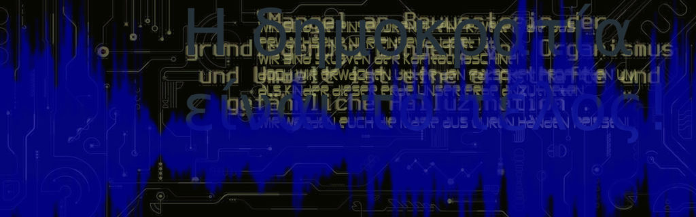

The neutrality of the Internet is not negotiable! It is not a question of preventing illegal activities, but of restricting freedom of speech.

A network, censored and controlled by authorities and companies, is only used to feed the capitalism machine and give small companies and individuals access to the market only through more and more money!

\*\*\*

Die Neutralität des Internets ist nicht verhandelbar! Es geht nicht darum, illegale Aktivitäten zu verhindern, sondern die Meinungsfreiheit einzuschränken.

Ein Netzwerk, das von Behörden und Unternehmen zensiert und kontrolliert wird, dient nur dazu, die Kapitalismusmaschine zu ernähren und kleinen Unternehmen und Einzelpersonen den Zugang zum Markt nur durch immer mehr Geld zu ermöglichen!

\*\*\*

La neutralité d'Internet n'est pas négociable! Il ne s'agit pas d'empêcher les activités illégales, mais de restreindre la liberté d'expression.

Un réseau, censuré et contrôlé par les autorités et les entreprises, n’est utilisé que pour nourrir la machine du capitalisme et donner aux petites entreprises et aux particuliers un accès au marché uniquement avec de plus en plus d’argent!

\*\*\*

¡La neutralidad de Internet no es negociable! No se trata de prevenir actividades ilegales, sino de restringir la libertad de expresión.

¡Una red, censurada y controlada por autoridades y empresas, solo se utiliza para alimentar la máquina del capitalismo y dar a las pequeñas empresas e individuos acceso al mercado solo a través de más y más dinero!

\*\*\*

La neutralità di Internet non è negoziabile! Non si tratta di prevenire attività illegali, ma di limitare la libertà di parola.

Una rete, censurata e controllata da autorità e società, viene utilizzata solo per alimentare la macchina del capitalismo e dare alle piccole imprese e ai singoli l'accesso al mercato solo attraverso sempre più denaro!

\*\*\*

互联网的中立性不可商议！ 这不是防止非法活动的问题，而是限制言论自由的问题。

由当局和公司审查和控制的网络仅用于养活资本主义机器，并且仅通过越来越多的钱就可以使小公司和个人进入市场！

\*\*\*

インターネットの中立性は交渉できません！ 違法行為を防ぐことではなく、言論の自由を制限することです。

当局と企業によって検閲および制御されるネットワークは、資本主義の機械に供給し、小企業と個人がますます多くのお金を通じてのみ市場にアクセスできるようにするためにのみ使用されます！

\*\*\*

Нейтралитет Интернета не подлежит обсуждению! Речь идет не о предотвращении незаконной деятельности, а об ограничении свободы слова.

Сеть, подвергаемая цензуре и контролируемая властями и компаниями, используется только для того, чтобы питать машину капитализма и предоставлять небольшим компаниям и частным лицам доступ к рынку только через все больше и больше денег!

\*\*\*

Az internet semlegessége nem tárgyalható! Nem az illegális tevékenységek megelőzéséről, hanem a szólásszabadság korlátozásáról van szó.

A hatóságok és a társaságok cenzúrázott és ellenőrzött hálózatát csak a kapitalizmus gépe táplálására használják, és csak egyre több pénzzel biztosítják a kisvállalkozások és magánszemélyek számára a piacra jutást!

\*\*\*

حياد الإنترنت غير قابل للتفاوض! إن الأمر لا يتعلق بمنع الأنشطة غير القانونية ، وإنما بتقييد حرية التعبير.

لا يتم استخدام شبكة ، تخضع للرقابة والتحكم من قبل السلطات والشركات ، إلا لإطعام آلة الرأسمالية ومنح الشركات الصغيرة والأفراد الوصول إلى السوق فقط من خلال المزيد والمزيد من الأموال!

\*\*\*

Η ουδετερότητα του Διαδικτύου δεν είναι διαπραγματεύσιμη! Δεν πρόκειται για την πρόληψη παράνομων δραστηριοτήτων, αλλά για τον περιορισμό της ελευθερίας του λόγου.

Ένα δίκτυο, λογοκριμένο και ελεγχόμενο από τις αρχές και τις εταιρείες, χρησιμοποιείται μόνο για να τροφοδοτεί την μηχανή του καπιταλισμού και να δίνει στις μικρές επιχειρήσεις και τα άτομα πρόσβαση στην αγορά μόνο με όλο και περισσότερα χρήματα!

\*\*\*

İnternetin tarafsızlığı pazarlığa açık değil! Bu yasadışı faaliyetleri önleme değil, konuşma özgürlüğünü kısıtlama meselesidir.

Yetkili makamlar ve şirketler tarafından sansürlenen ve kontrol edilen bir ağ, yalnızca kapitalizm makinesini beslemek ve küçük şirketlere ve bireylere yalnızca daha fazla parayla pazara erişim sağlamak için kullanılır!

\*\*\*

Interneto neutralumas nėra apyvartinis! Tai nėra neteisėtos veiklos prevencijos klausimas, bet apriboto žodžio laisvė.

Tinklas, cenzūruotas ir kontroliuojamas valdžios, institucijų ir įmonių, yra naudojamas tik šerti kapitalizmo machanizmą, ir suteikti mažoms įmonėms ir asmenims būdą patekti į rinką tik per daugiau ir daugiau lėšų!

\*\*\*

بی‌طرفیِ اینترنت قابل بحث نیست مسئله جلوگیری از فعالیت های قانونی نیست، بلکه محدود کردن آزادی بیان است.

یک شبکه سانسور شده و کنترل شده توسط مقامات رسمی و شرکت‌ها، تنها به جهت تغذیه ماشین سرمایه‌داری و اعطای دسترسی بازار به شرکت های کوچک و اشخاص تنها از دریچه پولِ بیشتر و بیشتر است!

\*\*\*

https://youtu.be/BiqDZlAZygU

[  
net neutrality is dead?](https://www.eff.org/de/issues/net-neutrality)
