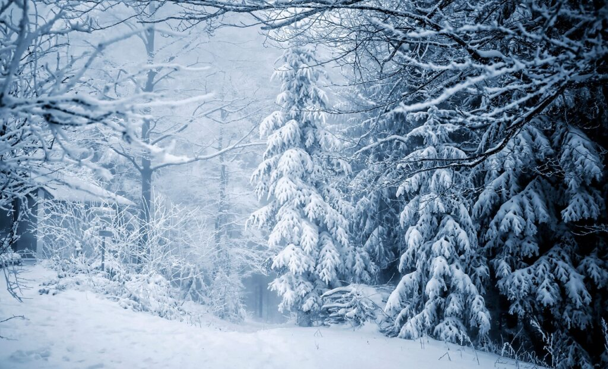

Die Bundesregierung hat die Kurzfristenergieversorgungssicherungsmaßnahmenverordnung, kurz EnSikuMaV, zum 1. September 2022 verabschiedet.

Mein Gas Anbieter:

_Senken Sie die Raumtemperatur um 1°C und sparen Sie damit bis zu 6% Gasverbrauch. Auf Ihren  
Jahresverbrauch in Höhe von 13.629 kWh geschaut, würde dies bei Ihrem Arbeitspreis von 8,85 ct./kWh  
eine Ersparnis von ca. 72,37 € ausmachen._

Ha ha das ist lustig.. die 72,37€ spar ich mir dann ;)

Der Durchschnittliche Gas Verbrauch einer Wohung dieser Größe, Altbau, 4 Personen:

32.800 kWh

41,55 % davon verbrauchen wir nur.. und ich soll jetzt die Temperatur um 1 Grad runter stellen und alle Türen zu machen.. wird dann ganz schön viel mehr sparen .. da wie bei den meisten Gasetagen Heizungen ein Thermostat irgendwo Zentral angebracht wird.. bei uns mit Erdgeschoss und Obergeschoss.. ist das oben im wärmsten Zimmer.. wenn wir die Türen schließen wird der Rest der Wohnung garnicht mehr geheizt.

Toller Spar-Tip Danke !

Vorallem Da es sich um ein Gartenhaus handelt.. Schimmel und Feuchtigkeit werden das Erdgeschass dann eh unbewohnbar machen ;)

Also besser Heizung um 2 Grad rauf schalten und die Absenk-Temperatur ebenfalls.

Was dann eventuell wirklich übers Jahr den Verbrauch senken würde..

<figure>

<figcaption>

Bild von [Robert C](https://pixabay.com/de/users/robert_c-1017101/?utm_source=link-attribution&utm_medium=referral&utm_campaign=image&utm_content=4727156) auf [Pixabay](https://pixabay.com/de//?utm_source=link-attribution&utm_medium=referral&utm_campaign=image&utm_content=4727156)

</figcaption>

</figure>

> [https://www.bmwk.de/Redaktion/DE/Downloads/E/ensikumav.pdf](https://www.bmwk.de/Redaktion/DE/Downloads/E/ensikumav.pdf)
> 
> Verordnung zur Sicherung der Energieversorgung über kurzfristig wirksame Maßnahmen.

Hört sich ja schon nach DDR 3.0 an.. Kollektive-Gesetzliche-Gassparmaßnahmen.
