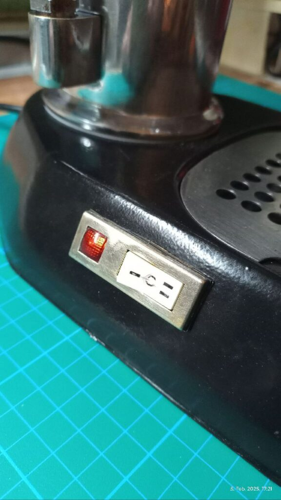
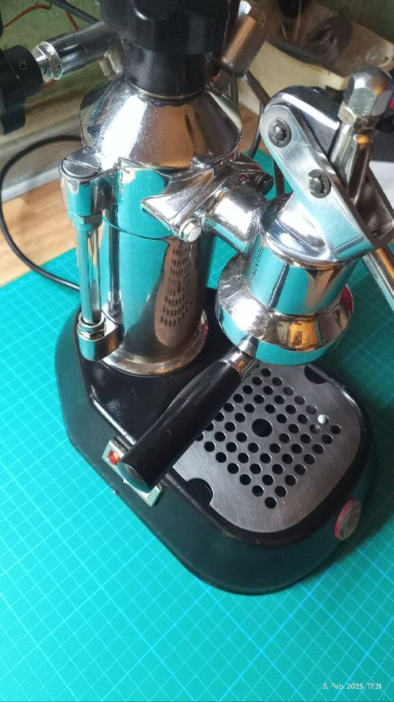
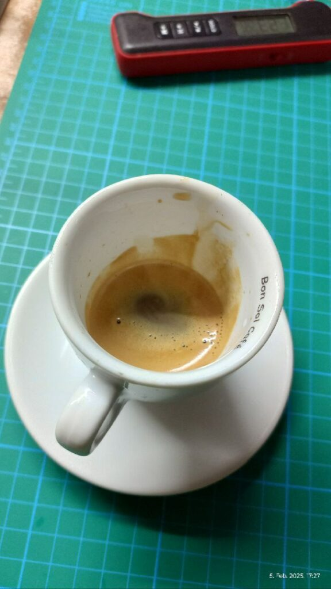
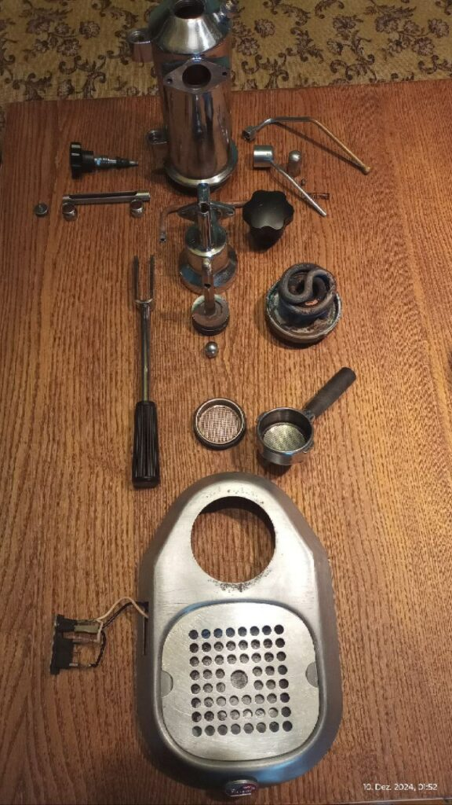
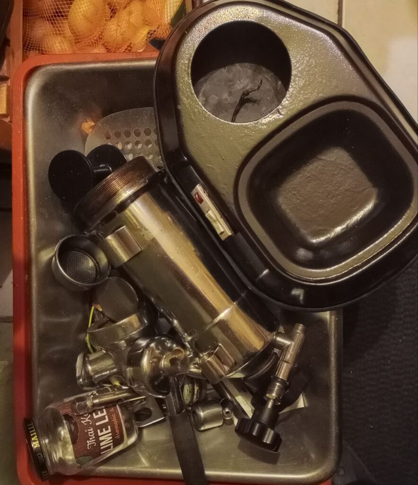
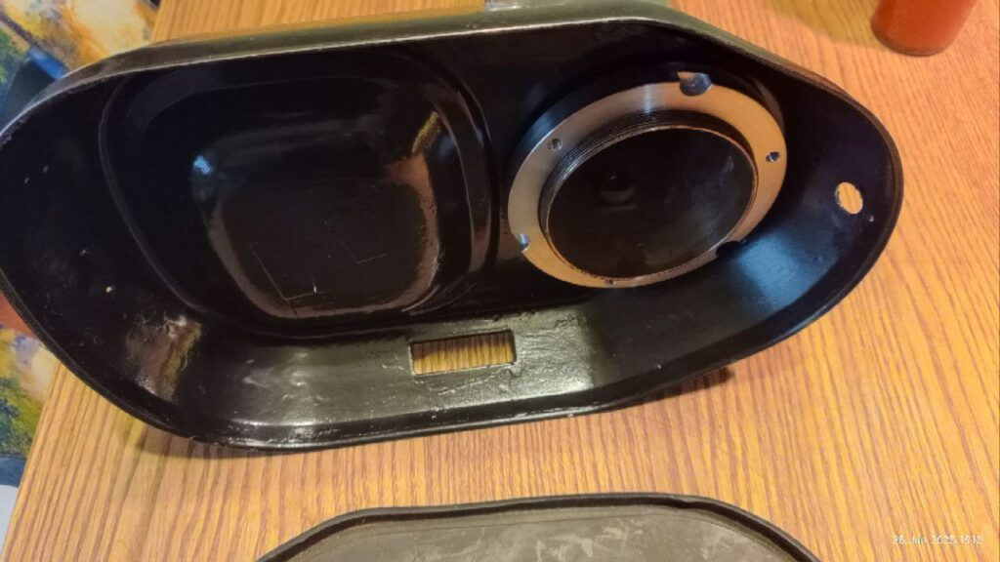
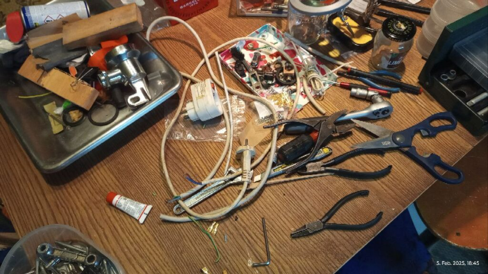
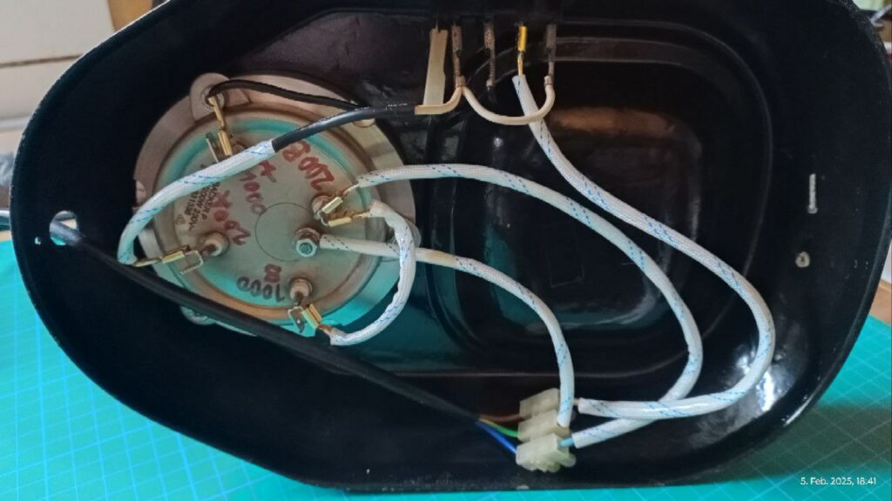
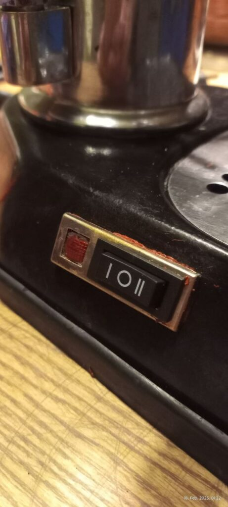
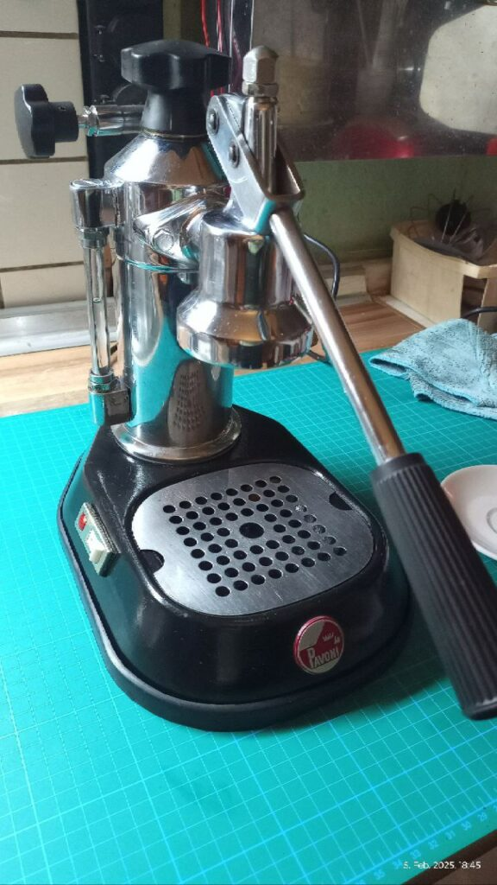

## **La Pavoni Europiccola Baujahr 1976**

Komplette Restaurierung nach dem vor Jahren die Heizung durchgeschmort war.

Durch Zufall habe ich den Tipp bekommen, dass es eine Adapterverschraubung gibt, die es möglich macht die Heizung neuerer Maschinen an die alten Maschinen zu installieren, die alte Form gibt es nicht mehr zu kaufen.

[https://coffee-sensor.com/product/la-pavoni-heating-element-boiler-flange-for-old-pre-82-machines](https://coffee-sensor.com/product/la-pavoni-heating-element-boiler-flange-for-old-pre-82-machines)

Die Meisten anderen Teile und Dichtungen plus Kesselsteinlöser e.t.c. besorge ich seit Jahren über Espresso XXL:

[https://www.espressoxxl.de/LA-PAVONI-ERSATZTEILE-FUeR-ESPRESSOMASCHINEN](https://www.espressoxxl.de/LA-PAVONI-ERSATZTEILE-FUeR-ESPRESSOMASCHINEN)

<figure>

https://youtube.com/shorts/MAPfYCTv49k?si=Wx2V\_PHIninIb6mH

<figcaption>

Video in dem die Machine zischt

</figcaption>

</figure>

