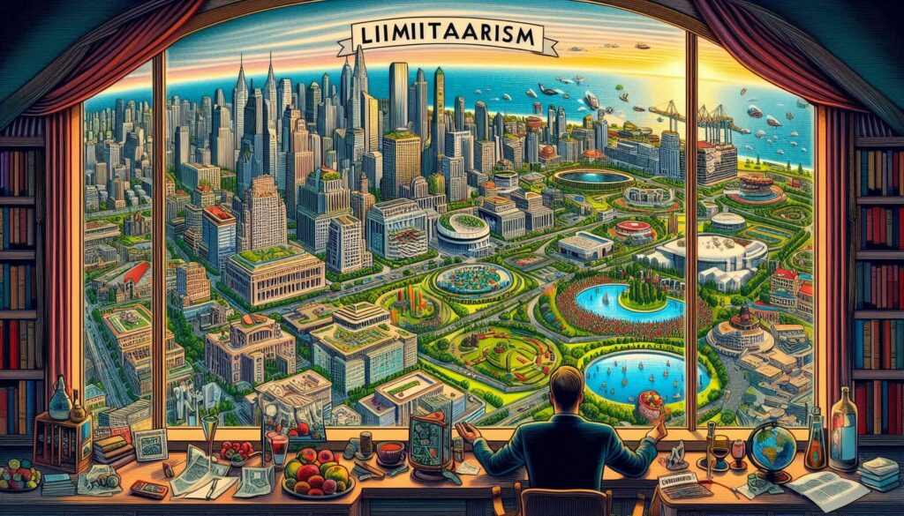

**Why wealth needs limits? / Warum Reichtum Grenzen braucht?**

> **Limitarianism** refers to several different types of ethical theories. Though limitarianism applies differently to varied fields of study, what is always common is an examination of when it is proper, moral or ethical to interfere and intervene in the lives and freedoms of individuals, in order to benefit society as a whole. It sometimes presents as a principle of distributive justice in economic theories (_economic limitarianism_). Unlike encompassing systems of political and economic intervention, which seek to make dramatic changes to the social order, limitarianism deals with specific instances and subjects, for which the necessity and justification of intervention may be examined. As its name implies, limitarianism asks the question of how setting certain limits for human beings can lead to positive outcomes.
> 
> [Wikipedia](https://en.wikipedia.org/wiki/Limitarianism_\(ethical\))

Wer will, dass niemand in Armut lebt und zu viel Ungleichheit für schlecht hält, muss für eine Obergrenze für Vermögen sein. Ein altes Konzept von Aristoteles und Platon neu denkt: der **Limitarismus**.

**Ingrid Robeyns:** _Ein revolutionäres Konzept zur Begrenzung exzessiven Reichtums, das eine gerechtere Welt für alle schaffen würde._

**Wohlstand? Was ist das eigentlich?**  
Es ist ja eben nicht das, was ein „Arbeiter“ sich erarbeitet – sein kleines Haus und sein Auto. Das ist kein Wohlstand, das sind Abhängigkeiten von Lohnarbeit.

Dieser Arbeiter hortet keine riesigen Mengen Geld, sondern er gibt sein Geld aus: für den Grundbedarf, sein Haus, den Garten, sein Auto.

Die Vielzahl der Arbeiter, Angestellten, Lohnabhängigen – wie auch immer man sie nennen will – sie füttern den Kreislauf des Geldes. Aber was tun Reiche? Die, die so viel Einkommen haben, dass sie es gar nicht ausgeben können? Deren Geld verschwindet aus dem Kreislauf – nicht vollständig, klar, aber ein immer größer werdender Teil davon wird einfach in Besitz gebunden, der dann nicht mehr in den Kreislauf zurückkehrt. Utopische Mengen an Besitz – Menschen, die 100.000-mal mehr Vermögen haben, als sie in einem Leben ausgeben könnten.

Oft ist es zudem so, dass der Gewinn, den Reiche erwirtschaften, nicht durch ihre eigene Arbeit entsteht, sondern zum großen Teil durch die Arbeit (körperlich) anderer. Da kann man jetzt sagen: „Okay, der hat eben jemanden angestellt und mit ihm einen Lohn ausgehandelt. Wenn er so schlau ist, mit deiner Arbeit ein Vielfaches mehr zu verdienen, als er dir bezahlt, ist das Wirtschaft.“ – Nur eben nicht ganz. Denn der Angestellte ist durch diese Arbeit nicht wohlhabend, sondern lohnabhängig.

**Übergewinne und Reichtum jenseits des menschlichen Vorstellungsvermögens führen zu einer Tatsache:**  
Diese Geldmengen kommen beim Großteil der Menschen nicht mehr an – in keiner Weise. Nicht als Lohn, nicht als Park oder Straßenbahn, nicht als Schule und auch nicht als Altersheim.

Also: Wenn wir das System „Geld“ nicht ändern wollen oder können, müssen wir anfangen, Reiche zur Verantwortung zu ziehen. Der Schutz muss weg. Ich meine – guck mal, die sprechen schon davon: „Wir müssen kriegstüchtig werden.“ Wer von uns will das? Krieg als letzte Lösung, um die Reichen weiter zu schützen? Die können sich ja schützen – aber wollen die wirklich in so einer Welt leben?

* * *

If you want no one to live in poverty and think too much inequality is bad, you have to be in favor of an upper limit on wealth. Rethinking an old concept of Aristotle and Plato: **limitarism**.

**Ingrid Robeyns:** _A revolutionary concept to limit excessive wealth that would create a fairer world for all._

**Prosperity? What even is that?**  
It’s certainly not what a "worker" earns — a small house and a car. That’s not prosperity; those are dependencies on wage labor.

This worker doesn’t hoard vast amounts of money. He spends it — on basic needs, his house, the garden, the car.

The vast number of workers, employees, wage-dependent people — whatever you want to call them — they feed the cycle of money. But what about the rich? Those who have so much income that they can’t even spend it all? Their money disappears from the economic cycle — not entirely, of course, but an ever-growing portion of it gets tied up in assets that no longer circulate. Absurd amounts of property — people who have 100,000 times more wealth than they could ever spend in a lifetime.

And often, the profits the rich earn don’t come from their own labor but largely from the (physical) labor of others. Now, one could say: “Well, they hired someone and negotiated a wage. If they’re smart enough to make a multiple of what they pay from your work, that’s business.”  
But that’s not the whole story. Because the employee doesn’t become wealthy through that work — they remain wage-dependent.

**Excessive profits and unimaginable wealth lead to one simple truth:**  
These vast sums of money no longer reach the majority of people — in any form. Not as wages, not as parks or public transit, not as schools, and not as nursing homes.

So if we don’t want to — or can’t — change the system of money itself, then we must start holding the rich accountable. The protections must go.  
I mean, look: they’re already talking about how “we need to become ready for war.”  
Who among us wants that? War as a last resort to keep protecting the rich? Sure, they can protect themselves — but do they really want to live in a world like that?
