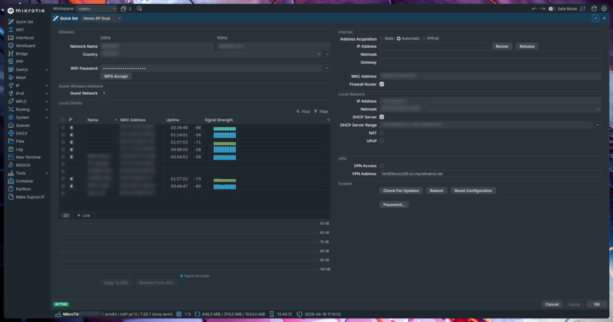
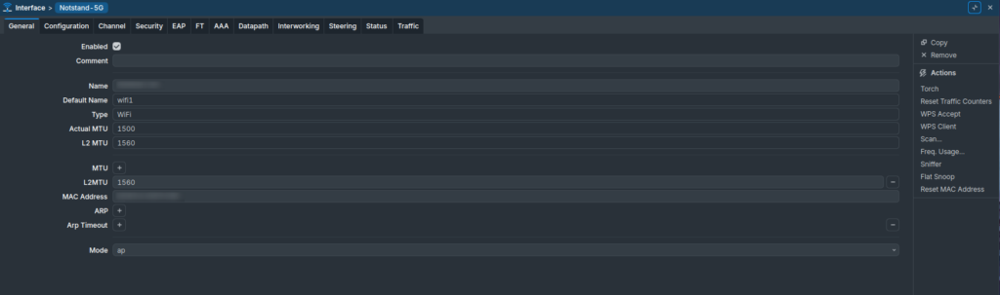
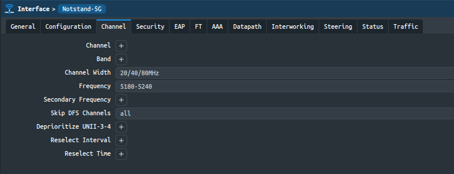
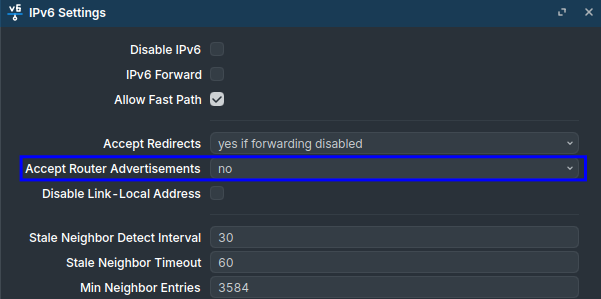
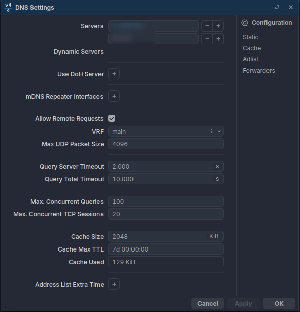
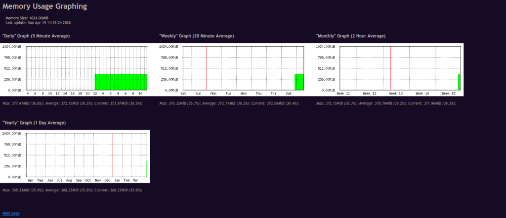

Looking to ditch the standard router from your ISP? You’ll likely end up looking at MikroTik. Right now, the **hAP ax³** is one of the most exciting gadgets out there. It offers massive hardware power for a fair price, though it does ask you to roll up your sleeves and do some manual configuration.

After putting it through its paces for a few days .. handling everything from an old Android home phone to HD streaming on tablets to get the best out of the wifi setup. here are my main takeaways for you.

[https://mikrotik.com/product/hap\_ax3](https://mikrotik.com/product/hap_ax3)

### The Hardware: It’s a Powerhouse

The hAP ax³ packs a Quad-Core ARM CPU that barely breaks a sweat during daily tasks. This means you have plenty of extra power for "bonus" services:

- **Performance:** Even with multiple streams and VoIP calls running at once, the CPU load stays super low.

- **Versatility:** Thanks to the USB port and Docker support, you can run services like **Pi-hole** or **AdGuard Home** directly on the router. No need for extra hardware like a Raspberry Pi!

### Tweaking Your Wi-Fi: Success is in the Details

This router uses the new Wi-Fi menu in [RouterOS.](https://mikrotik.com/software) To get the best range and stability, you need to understand how a few settings work together:

- **Power & Gain:** MikroTik automatically limits signal strength based on the "Antenna Gain" you enter. In many regions (like Germany), there are strict legal limits. If you enter the wrong values here, your connection might drop frequently.

- **The "Distance" Setting:** This one is often overlooked! Instead of leaving it on "dynamic," set it manually to **1 (km)** for an apartment. This improves timing and stops video streams from stuttering.

- **Frequency Tips:**
    - **2.4 GHz:** To keep older devices (like that Android 8 home phone) happy, stick to a fixed 20MHz width on channels 1, 6, or 11. (use **_Freq. Usage_** option to check what is used in your neighborhood)
    
    - **5 GHz:** Want to avoid that annoying 1-minute silence when the router starts [(DFS wait)?](https://en.wikipedia.org/wiki/Dynamic_frequency_selection) Stick to channels 36 through 48.

### Privacy: Take Back Your DNS

A huge plus with MikroTik is total control over your DNS. Instead of using your provider's servers—which can be slow or filtered—you can set up private alternatives like **Quad9** or **Cloudflare** for both IPv4 and IPv6.

> **Pro Tip:** Make sure to uncheck **"Use Peer DNS"** in your internet settings. This prevents your ISP from secretly pushing their own servers back onto your device.
> 
> **Pro Tip:** In Case you will need to force that your own DNS servers are used and it is not getting them from your bad acring ISP: go to **IPv6 -> Settings** and set **Accept Router Advertisements** to "**no**" apply and reboot the router to clean cache and stuff (easiest way) after this you should not have "**Dynamic Servers**" showing up under **IP ---> DNS** anymore. ( i had to do so may caused by 1 und 1 Fibre Modem Black Box)
> 
> 
> 
> 

### Monitoring: Keep an Eye on Everything

MikroTik has a great built-in tool for visuals. If you go to `Tools -> Graphing`, you can see live charts of your traffic, CPU usage, and RAM.

You can watch this in a Browser tab:

### My Verdict?

The hAP ax³ is definitely not a "Plug & Play" device. You have to be willing to learn the ropes of RouterOS, and get some knowledge on how complex Networking is, also if its only you little local Network ;) . But if you do, you’re rewarded with:

1. A rock-solid network.

3. Total privacy

5. A total new hobby?

7. A future-proof setup and Hardware

**What’s next?** For many of us, the next logical step is setting up a [WireGuard](https://www.wireguard.com/) VPN for secure remote access and getting a network-wide adblocker ([PI-Hole](https://pi-hole.net/)) running in a container.
