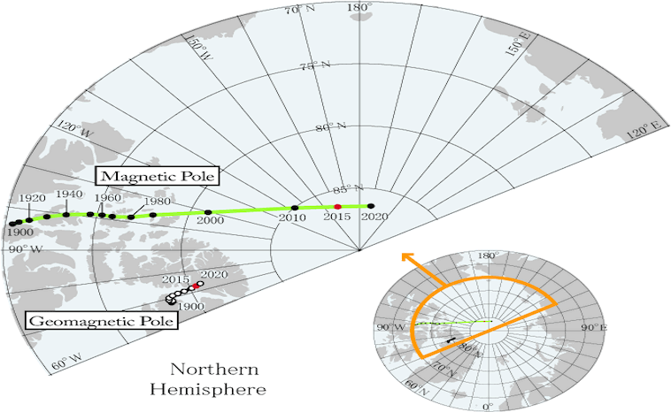

Welcome to 2023 the year of Cleavage.

Source: [https://agupubs.onlinelibrary.wiley.com/doi/10.1029/2023GL103509](https://agupubs.onlinelibrary.wiley.com/doi/10.1029/2023GL103509)

Der Nordpol hat sich Forschern zufolge in den Jahren 1993 bis 2010 um 4,36 Zentimeter pro Jahr verschoben - insgesamt knapp 80 Zentimeter

- Aufgrund der Erschöpfung des Grundwassers und des daraus resultierenden Anstiegs des Meeresspiegels driftete der Erdpol zwischen 1993 und 2010 mit einer Geschwindigkeit von 4,36 cm/Jahr in Richtung 64,16° E
- Unter Berücksichtigung der Auswirkungen der Grundwasserverknappung stimmt die geschätzte Drift des Rotationspols der Erde bemerkenswert gut mit den Beobachtungen überein.

> ### Schlussfolgerungen
> 
> Globale Klimamodellschätzungen deuten darauf hin, dass die Grundwasserverknappung einen wesentlichen Beitrag zum GMSL-Anstieg leistet. Seit dem Start von GRACE zeigen Beobachtungen der zeitlich veränderlichen Schwerkraft eine starke Erschöpfung des Grundwassers und einen daraus resultierenden Anstieg des Meeresspiegels. Vor der GRACE-Mission deuteten die GMSL-Budgets auf einen Rückgang des Grundwassers hin, es fehlte jedoch eine Bestätigung durch direkte Beobachtungen auf globaler Ebene. Eine unabhängige Bestätigung des Beitrags des Grundwassers zu GMSL-Änderungen könnte durch Variationen in der dynamischen Abplattung der Erde und der Polarbewegung (PM) erfolgen. Wir haben festgestellt, dass dies für diesen Zweck aufgrund der Geographie (niedrige Breiten) der Grundwasserleiter, die in diesem Zeitraum erschöpft wurden, und der Unsicherheit bei den GIA-Vorhersagen diesbezüglich nicht besonders nützlich ist. Andererseits reagiert die PM-Anregung für den Zeitraum 1993–2010 empfindlich auf globale Grundwasserveränderungen, und beobachtete und vorhergesagte PM-Anregungen stimmen gut miteinander überein. Wir fanden heraus, dass die Grundwasserverknappung die zweitgrößte Komponente (4,36 cm/Jahr) des PM-Anregungstrends in Richtung 64,16° E im Zeitraum 1993–2010 war. Unter den bekannten Quellen der PM-Anregung sind Grundwasserveränderungen besonders wichtig, um die Komponente zu erklären, die in Richtung 90° östlicher Länge tendiert. Die Vernachlässigung der Grundwasserverknappung im PM-Anregungshaushalt führt zu einem Trend, der stärker nach Westen verläuft als beobachtet. Verschiedene Auswahlmöglichkeiten für Schätzungen anderer Oberflächenmassenlastbeiträge führen zu derselben Schlussfolgerung. Dies bestätigt, dass die Erschöpfung des Grundwassers eine Hauptursache für den GMSL-Anstieg in den letzten Jahrzehnten ist, wie diese Modelle bereits gezeigt haben.

* * *

According to researchers, the North Pole shifted by 4.36 centimeters per year between 1993 and 2010 - a total of almost 80 centimeters

- Earth's pole has drifted toward 64.16°E at a speed of 4.36 cm/yr during 1993–2010 due to groundwater depletion and resulting sea level rise
    
- Including groundwater depletion effects, the estimated drift of Earth's rotational pole agrees remarkably well with observations.

> ### Conclusions
> 
> Global climate model estimates indicate that groundwater depletion is a significant contributor to GMSL rise. Since the launch of GRACE, observations of time-variable gravity show large amounts of groundwater depletion and resulting sea level rise. Prior to the GRACE mission, GMSL budgets indicated declining groundwater, but confirmation from direct observations was lacking on a global scale. Independent confirmation of groundwater's contribution to GMSL changes might come from variations in Earth's dynamic oblateness and polar motion (PM). We found that is not especially useful for this purpose because of the geography (low latitudes) of aquifers that have been depleted in this period, and uncertainty in GIA predictions regarding. On the other hand, PM excitation, for 1993–2010 is sensitive to global groundwater changes, and observed and predicted PM excitations agree well with each other. We found that groundwater depletion was the second largest (4.36 cm/yr) component of PM excitation trend toward 64.16°E during 1993–2010. Among known sources of PM excitation, groundwater changes are particularly important to explain the component, trending toward 90° east longitude. Neglecting groundwater depletion in the PM excitation budget leads to a trend that is more westward than observed. Various choices for estimates of other surface mass load contributions lead to the same conclusion. This confirms that groundwater depletion is a major source of GMSL rise during the last a few decades as previously indicated by these models.
