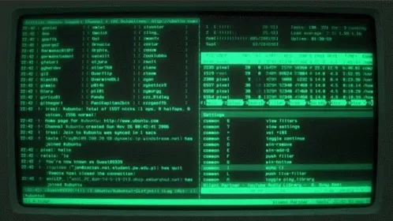

Is it really such a high burden to be in the need to use the terminal?

Isn’t this simply about a mindset? Or misunderstanding of the thing itself? Running a command in the terminal.

Often people say something like "writing commands by hand" we do write commands by hand all day long nowadays in a high complex programming language. It's called human communication.

In case we need to learn a new language too as we need it to work remote or migrating to another country.

I would not think about that if I go to Japan and want to buy a sandwich on a store that they have to read my mind or have an autotranslator machine to be able to understand me in my native language.

From my experience coming from a time in what we do not had GUI apps for most things we had to use terminal commands reading man pages in terminal (no internet resources) going into an age with GUI for everything but went back to use terminal as of its simply faster without all the clutter in a lot of cases.

If I do not know how, the info is only an `app-name --help` or `man app-name` away, or I can watch a video about it and the internet bis full of help forums chats.

Next time I know, same as if I learn a new word in English or a better way to form a sentence.

- Things like locating files compared to using a file browser. The result is immediately there.

- to open an application in terminal no need to open a cascading menu search for the name click on it e.t.c. it right at your fingertip

- What if ... X-Server is not working? You are **doomed** ? ---> **No!** Ctrl + Alt + F4 TTY is right at hand ready for your input.

These are just a few examples now, but think about it. I know one thing, in the future, the terminal will be a widespread tool that is efficient to work on systems. Tools come to me that also contribute to this. Auto-Completing, History-Search, Auto-Suggestions...

So stay tacked by your power and the terminal is far away from an unnecessary horror tool, only used by enlightened computer gurus.
