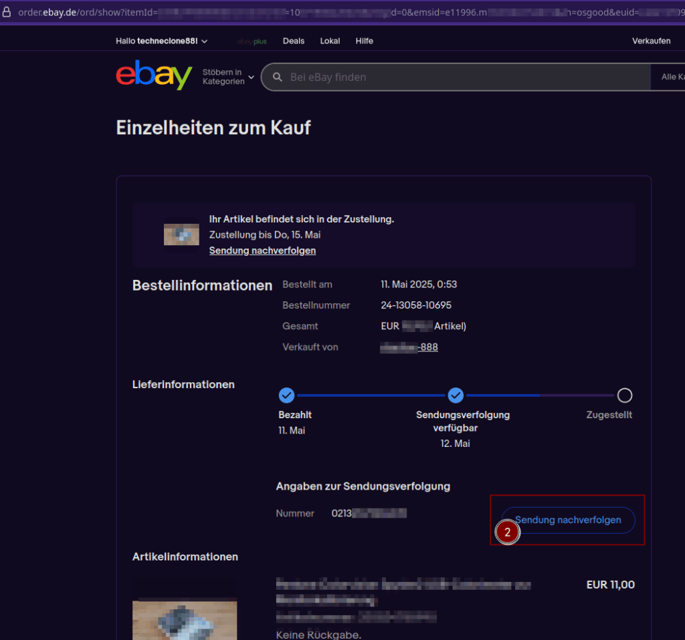
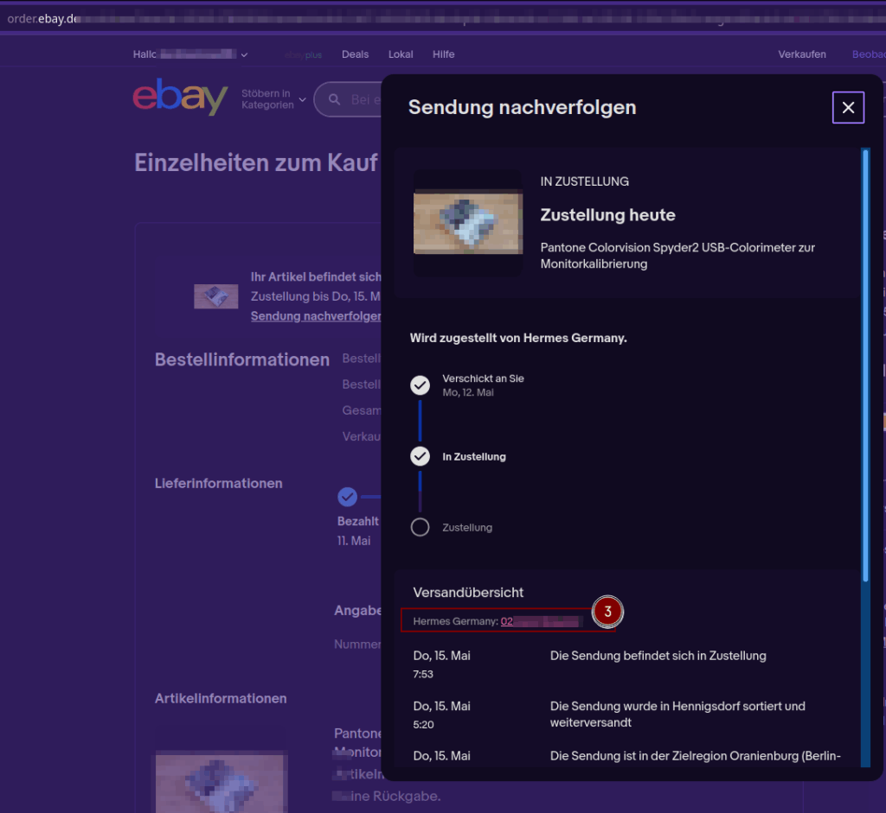
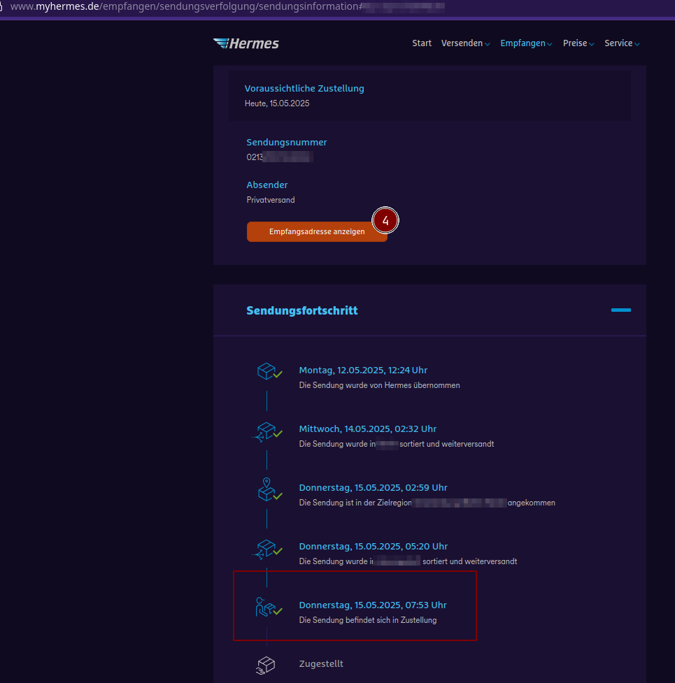

## **seriously, it does very hard in every corner of our commercial life!**

A collection of daily [idiocracy](https://en.wikipedia.org/wiki/Idiocracy)

Act 1:

## Ebay and Hermes got marriaged?

Got mail from eBay that my item will get delivered today (that's a good info and I could have stopped my afford at the moment I read the mail.)

But ...

it had buttons (colorful)

Click 1 --> brings me on the eBay webside to this:

You see same info okay .. same button to click.. as in the mail..

click2 ---> brings up a popup with a lot of going on...

Not really any more info about the details.. i would say its ... the exact same info i got in the mail already..

Click 3 --->

Leaving eBay website, no at Hermes… But the info? Hmm, exactly the same I got in the mail already... But I got option to … Show Address of destination of the delivery! Cool (may I forget about my own address?)

click 4 --->

They say I have to input the postal code of the delivery address for the safety..

Clock 5 --->

Now. Finally (that's the end of the process) I got to see my postal code and my name with the Title "Address of delivery"

Taken me like 10 Minutes to go there. While that, the parcel got delivered at my neighbors, no ring on the door behind me.

And why? I think it could have a relation… The delivery guy simply does not mind about, as off machines do that …

Automation is a great thing but… Humans are not machines, we do not need information without value, machines should serve us with the needed information to make life easier, and they should save time not taken our time.

All this is running on electronics in several data plants all over the planet, consuming energy, but not only that it is stealing our time, lifetime, work time.

I mean should we start sending bills on the Hermeses and eBays ?
