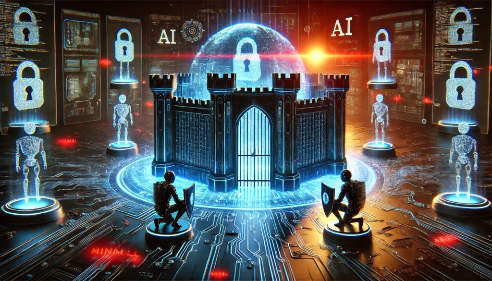

Von Außen gesehen hat ein OS nur ein paar Öffnungen, wenn, die alle abgesichert sind, kann das OS nichts machen, die Mechanismen dürfen nur eben nicht durch das OS gesteuert werden können. Z.B. ein Schalter, der das Netzwerkkabel trennt, da kann kein Virus, das wieder einschalten (Beispiel).

Mit dem OS soll aber Arbeit erledigt werden, wie z.B. Kommunikation nach Außen, und ja der Benutzer muss auch auf das OS zugreifen über Tastatur, Sensoren, Maus, Datenträger. Also gibt es eine riesige Oberfläche, die offen für Angriffe ist am OS und der Workstation selbst. Daher wird ein Betriebssystem, das alle möglichen Anwendungsmöglichkeiten aktiv unterstützt und bereithält, keine ausreichende Sicherheit bieten können. Wenn dieses auch noch von einem Unternehmen entwickelt wird, das einzig und allein Interesse an Gewinnen und Daten hat?

Die Idee ist, dass ein OS sozusagen in einem Hochsicherheitslabor entwickelt wird, das von der nutzenden Organisation allein verwaltet wird und nicht von einem Unternehmen, das so gesehen einbauen kann, was für ein Trojaner auch immer.

In wenigen Jahren müssen "Systemangriffe" die von KI Skripten, Würmern usw. erzeugt wurden, abgewehrt werden, eine völlig neue Dimension der Komplexität darstellen.

Die Folge davon kann sein, dass Betriebssysteme wie Windows und OS-X komplett vom Markt verschwinden, da sie dem nicht gewachsen sind. Stattdessen eine riesige Zahl von spezialisierten Betriebssystemen gibt, die nur mit einem Bausteinsystem (LEGO) wie Linux zu entwickeln sein werden?

* * *

From the outside, an OS has only a few entry points. If all of these are secured, the OS cannot take any action, as long as critical mechanisms are not controlled by the OS itself. For example, if a physical switch disconnects the network cable, no virus could turn it back on.

However, an OS is needed for work, including external communication. Users must interact with it via keyboard, sensors, mouse, or data carriers, creating a vast attack surface for both the OS and the workstation. Therefore, an operating system that actively supports and maintains all possible applications cannot provide sufficient security—especially if it is developed by a company whose primary interest lies in profit and data collection.

The idea is to develop an OS in a high-security environment, managed by an independent organization rather than a company that might introduce hidden backdoors or Trojans.

In the coming years, AI-generated scripts, worms, and other system attacks will reach an entirely new level of complexity.

As a consequence, mainstream operating systems like Windows and macOS may completely disappear from the market, as they may no longer be able to meet these security challenges. Instead, we could see a rise in highly specialized operating systems, developed using a modular (LEGO-like) system—similar to Linux.
