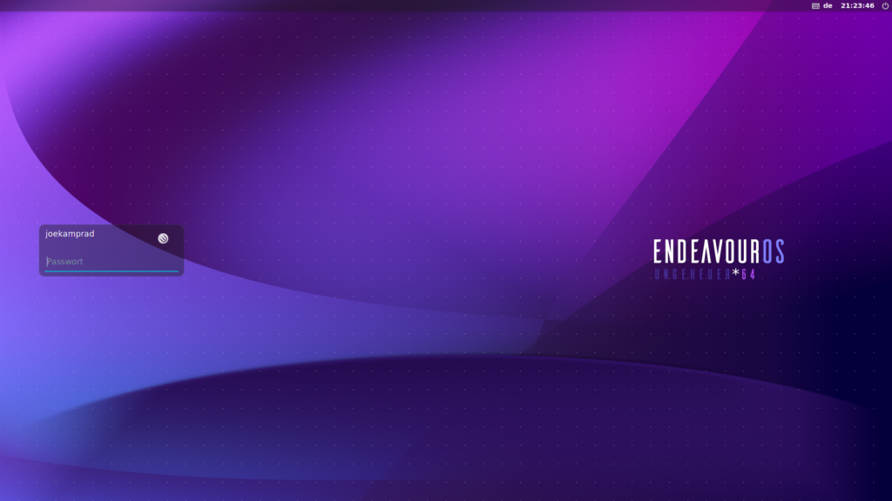
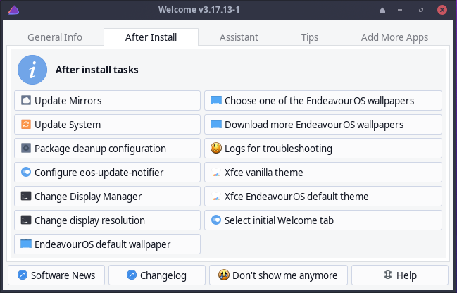

- **No!** EndeavourOS is not a full hand-holding replacement for Windows or a fully controlled locked-down noob friendly Operating System. It allows you to do what ever you can imagine to do with your own System, the good, the funny and also the bad, destructive actions that possible will destroy the OS. you may loose your mind!

- As close to Archlinux as possible, no holding back updates for packages and no custom kernel builds, no overloaded pre-selection of applications that come pre-installed, and only minimal pre-configurations and minimal customization needed to start your custumizations with.

- The approach is more of providing help and guidance that allows the user to customize the system to suit the user's needs, as the user will be able to troubleshoot and understand how everything works on their own.

- EndeavourOS does not provide a graphical package shop as a pre-installed default, but supports the confrontation, like Archlinux itself, of using pacman directly in the terminal, and [yay](https://github.com/Jguer/yay) in the terminal to [AUR Build and manage packages](https://aur.archlinux.org/).

- EndeavourOS has developed some system apps to simplify management, but they always access commands and programs that can also be used in the terminal. So no automatic administration where you as a user no longer have to understand what is actually happening.

- EndeavourOS isn't aimed at everyone and anybody, but welcomes anyone, regardless of skill level, who is willing to get to grips with Archlinux and is willing to learn.

**Links:**

[https://forum.endeavouros.com/](https://forum.endeavouros.com/)

[https://discovery.endeavouros.com/](https://discovery.endeavouros.com/)

[https://github.com/endeavouros-team](https://github.com/endeavouros-team)

[https://en.wikipedia.org/wiki/EndeavourOS](https://en.wikipedia.org/wiki/EndeavourOS)
