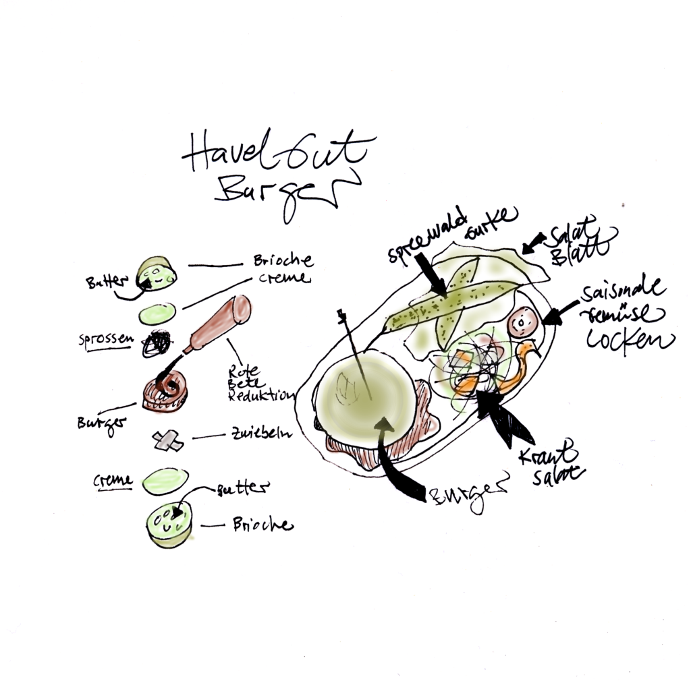
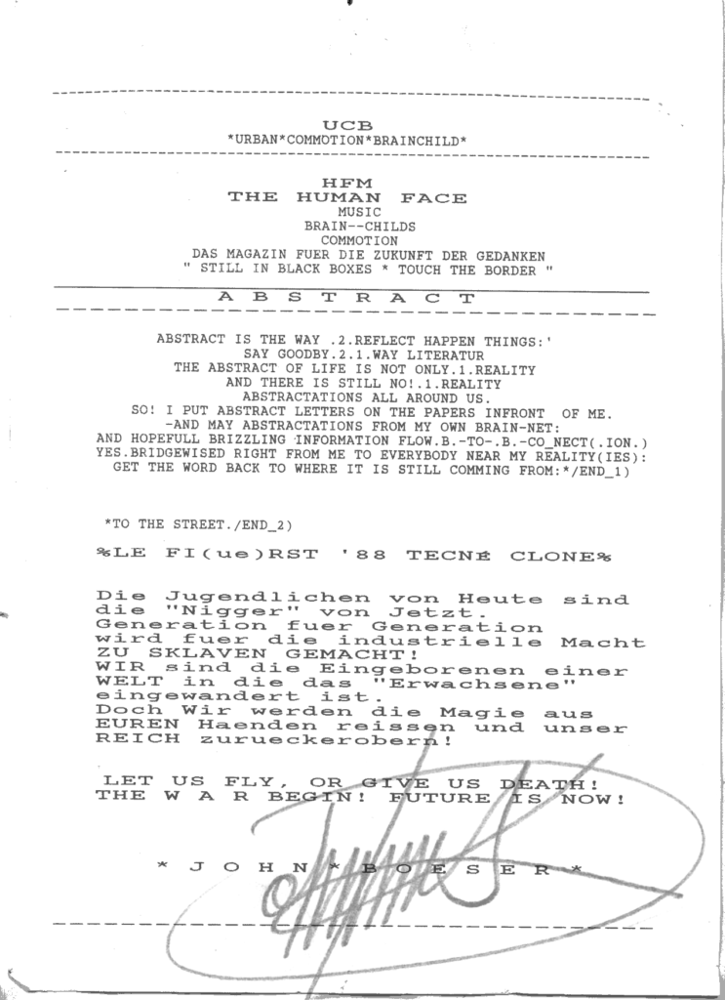
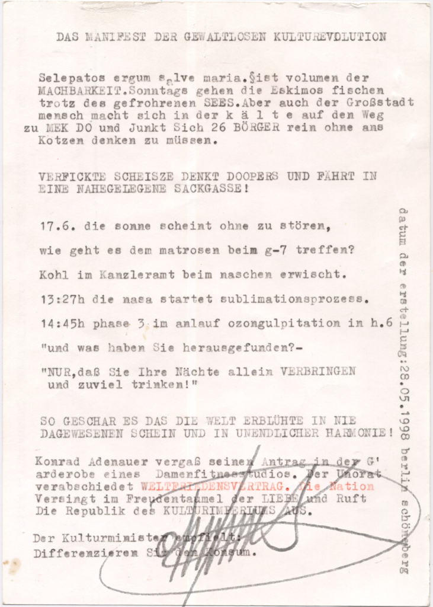
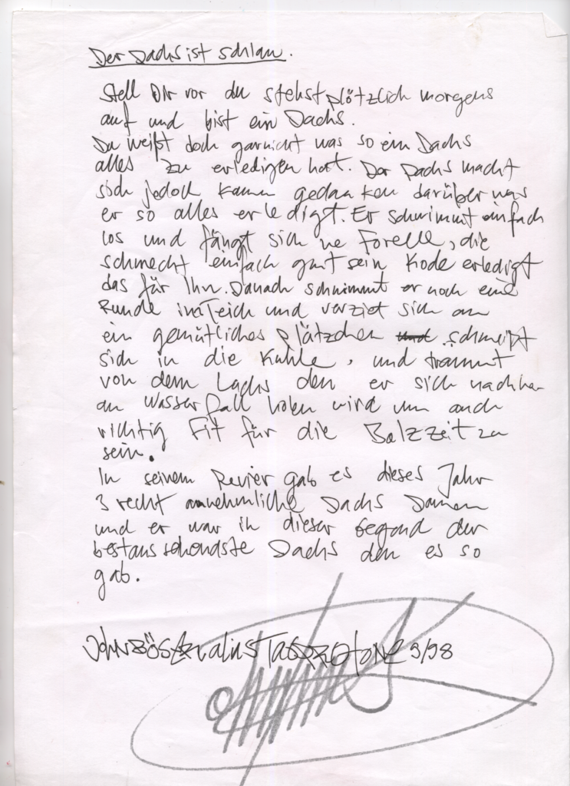
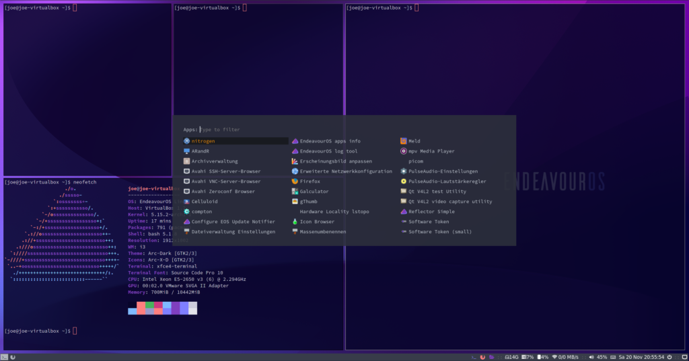
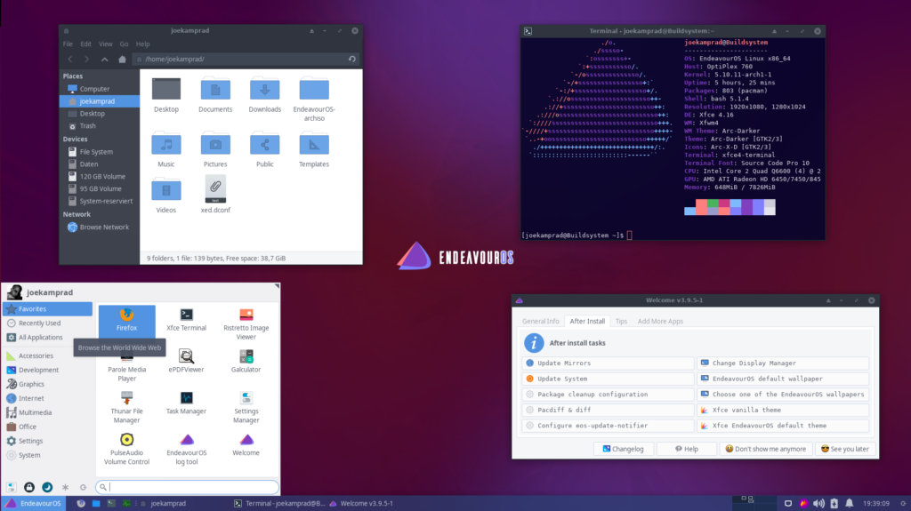
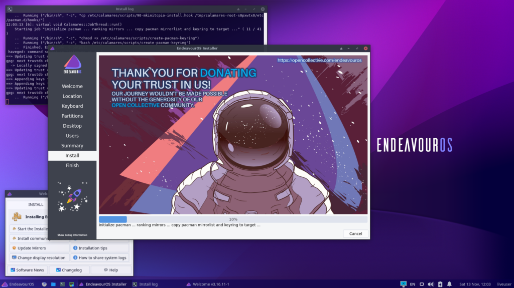
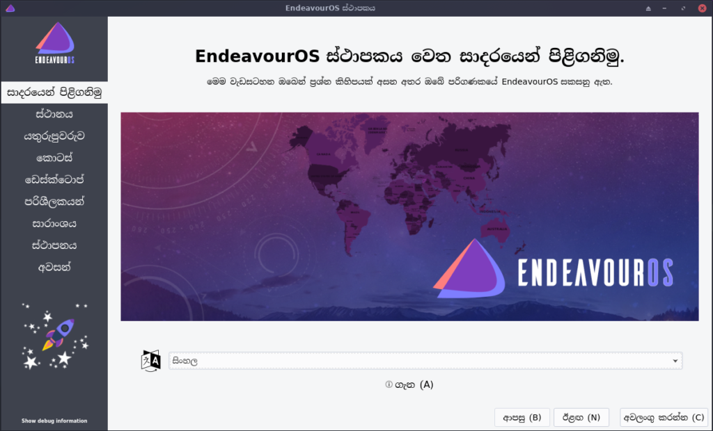

## #art#work#typographics

  

  

  

  

  

## **code#works:**

[https://github.com/endeavouros-team/endeavouros-i3wm-setup](https://github.com/endeavouros-team/endeavouros-i3wm-setup)

[https://github.com/endeavouros-team/endeavouros-xfce4-theming](https://github.com/endeavouros-team/endeavouros-xfce4-theming)

[https://github.com/endeavouros-team/EndeavourOS-ISO](https://github.com/endeavouros-team/EndeavourOS-ISO)

[https://github.com/endeavouros-team/EndeavourOS-calamares](https://github.com/endeavouros-team/EndeavourOS-calamares)
